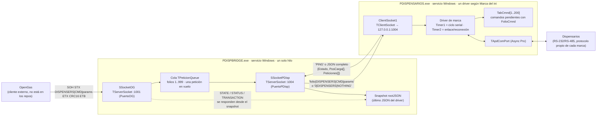
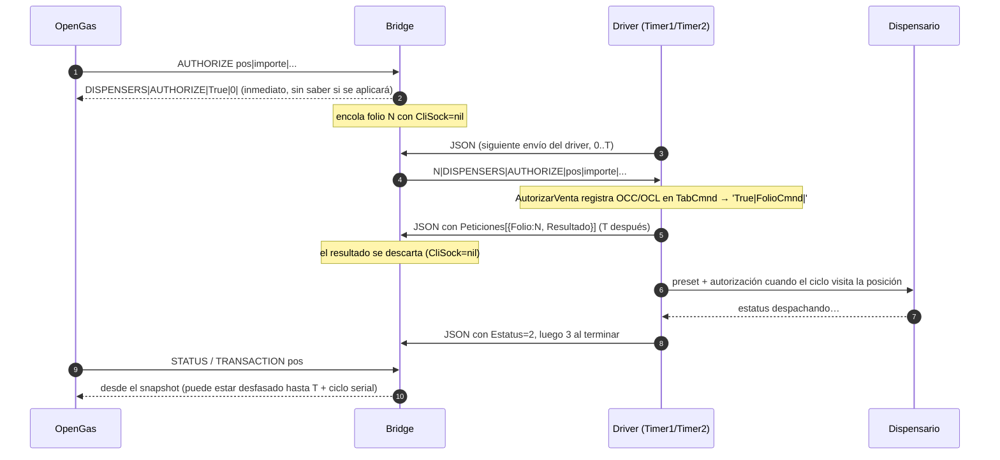
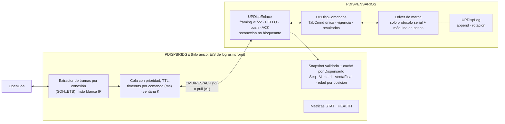
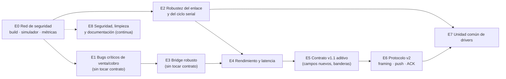

# Plan de optimización y mejora · PDISPENSARIOS + PDISPBRIDGE

> **Qué es este documento.** Es un plan detallado y por etapas para corregir, robustecer y optimizar los dos módulos que controlan los dispensarios:
>
> - `IgasDispensarios` (PDISPENSARIOS.exe, los drivers por marca);
> - `IgasDispensariosBridge` (PDISPBRIDGE.exe, el puente con OpenGas).
>
> Está pensado para **ejecutarse con una IA, un item a la vez**. Cada item dice qué hallazgos resuelve, qué archivos toca, qué pasos seguir y cómo verificarlo.
>
> **Dónde está el detalle.** El documento es idéntico en los dos repositorios. La evidencia de cada hallazgo (descripción, líneas, impacto y recomendación completa) está en `docs/plan-optimizacion/hallazgos/<MÓDULO>.md`.

**Contenido**

1. [Alcance, método y estado de la auditoría](#1-alcance-método-y-estado-de-la-auditoría)
2. [Cómo funcionan hoy los dos módulos entre sí](#2-cómo-funcionan-hoy-los-dos-módulos-entre-sí)
3. [Resumen ejecutivo: lo más grave](#3-resumen-ejecutivo-lo-más-grave)
4. [Diagnóstico por categoría (temas transversales)](#4-diagnóstico-por-categoría-temas-transversales)
5. [Arquitectura objetivo](#5-arquitectura-objetivo)
6. [Plan por etapas](#6-plan-por-etapas)
7. [Cómo trabajar este plan con una IA](#7-cómo-trabajar-este-plan-con-una-ia)
8. [Riesgos globales y estrategia de despliegue](#8-riesgos-globales-y-estrategia-de-despliegue)
9. [Pendientes de la auditoría](#9-pendientes-de-la-auditoría)
10. [Índice de hallazgos](#10-índice-de-hallazgos)

---

## 1. Alcance, método y estado de la auditoría

| Concepto | Valor |
|---|---|
| Código auditado | `IgasDispensarios@26ccfb4` (21-oct-2026) e `IgasDispensariosBridge@99edafd` (30-sep-2026) |
| Módulos incluidos | Bridge (`UIGASBRIDGE.pas`), interacción OpenGas ↔ Bridge ↔ drivers, y los drivers Wayne 2W, Wayne, Bennett, Team, PAM, Hong Yang, Gilbarco 2W y Triton |
| Fuera de alcance | **Kairos (Marca 7)**, por decisión del negocio. Además, Kairos no usa el Bridge: abre su propio puerto 1001 y habla directo con OpenGas. OpenGas tampoco se revisó, porque no está en estos repositorios |
| Método | Auditoría multiagente: un lector por módulo leyó el archivo completo y reportó hallazgos con archivo, líneas, evidencia, impacto y recomendación; un lector transversal analizó la interacción de punta a punta; verificadores escépticos revisaron los hallazgos críticos contra el código. El plan y las etapas los consolidó el autor de este documento |
| Hallazgos vigentes | **387** (sin Kairos), en 9 módulos de análisis. Ver la [sección 10](#10-índice-de-hallazgos) |

**Sobre la verificación.** Por el límite de uso de la sesión, solo los hallazgos **críticos** se enviaron a un verificador independiente; el resultado está en la columna «Verif.» del índice y en cada anexo. Los de severidad alta, media y baja se reportan como los encontró el lector, que siempre cita líneas y evidencia, pero **no tienen una segunda opinión**.

Por eso, **la primera tarea de la IA en cada item es confirmar el hallazgo en el código** antes de cambiar nada. Así lo pide la [plantilla de la sección 7](#7-cómo-trabajar-este-plan-con-una-ia). Si el hallazgo no se sostiene, se marca como descartado en el anexo y se sigue con el siguiente.

**Severidades usadas:**

- 🔴 **Crítica:** puede causar una venta o un cobro incorrecto, pérdida de transacciones, un dispensario bloqueado o la caída del servicio en condiciones realistas.
- 🟠 **Alta:** degrada la operación o pierde respuestas o datos en condiciones plausibles.
- 🟡 **Media:** ineficiencia notable o riesgo latente.
- ⚪ **Baja:** limpieza o estilo.

## 2. Cómo funcionan hoy los dos módulos entre sí

### 2.1 Piezas, procesos y puertos



- **PDISPENSARIOS.exe** (repo `IgasDispensarios`) enlaza los 9 drivers en un solo ejecutable. `PDISPENSARIOS.dpr` lee `[CONF] Marca` del ini y crea uno: 1 Wayne, 2 Bennett, 3 Team, 4 PAM, 5 Hong Yang, 6 Gilbarco 2W, 7 Kairos, 9 Wayne 2W y 10 Triton. Si la marca no existe, el servicio arranca sin driver. Cada driver es un `TService` con:
  - un `TApdComPort` hacia los dispensarios (Wayne 2W tiene dos),
  - `Timer1`, que es el ciclo de sondeo serial, con intervalos de 15 a 280 ms según la marca,
  - `Timer2`, que conecta y reconecta con el Bridge y manda PING o JSON mientras el driver no está en operación (200 ms),
  - un `TClientSocket` hacia el Bridge (`ServidorSocket`, por defecto `127.0.0.1:1004`).
- **PDISPBRIDGE.exe** (repo `IgasDispensariosBridge`) es un `TService` con dos `TServerSocket` no bloqueantes y un `TTimer` de 500 ms (`TimerTimeout`) creado en `ServiceExecute`. Todo corre en el hilo del servicio (verificado), así que una escritura lenta a disco congela a OpenGas, al driver y a los timeouts al mismo tiempo.
- **Kairos (Marca 7) es la excepción y queda fuera del alcance de este plan.** No usa el Bridge: abre su propio `TServerSocket` en el puerto 1001 y habla directo con OpenGas, con su propio contrato. Si alguien configura en la misma máquina el Bridge y Kairos, los dos pelean por el puerto 1001.
- **Dependencias externas no versionadas:** `ULIBGRAL` (ExtraeElemStrSep, NoElemStrSep, FiltraStrNum, FechaHoraToStr…), `CRCs`, Async Professional (`AdPort`, `OoMisc`), Indy (`IdHash*`) y RxLib (`RxMemDS`, que el Bridge declara sin usar). `uLkJSON.pas` (v1.07, 2009) y `UVersionModulo.pas` están copiados idénticos en los dos repos.

### 2.2 Contrato OpenGas ↔ Bridge (puerto 1001)

- **Trama:** `SOH STX <payload> ETX <CRC16 en 4 hex> ETB`. El payload es `DISPENSERS|<CMD>|<p1>|…|`. Con la cabecera `DISPENSERSX` el Bridge **no valida el checksum** (BRG-22). Un mensaje de un solo carácter `0` o `1` se trata como un comando legado (BRG-24, E2E-33).
- **Respuesta:** `DISPENSERS|<CMD>|True|<datos>|` o `DISPENSERS|<CMD>|False|<mensaje>|`, enmarcada igual. No lleva identificador de correlación: OpenGas solo puede emparejar por orden y por nombre de comando (E2E-20).
- **No hay buffer por conexión:** cada `ReceiveText` se trata como una trama completa. Dos tramas pegadas o una trama partida se pierden o se procesan mal (BRG-05).

| Tipo de comando | Comandos | Qué hace el Bridge |
|---|---|---|
| Local (snapshot) | `STATE`, `STATUS [pos]`, `TRANSACTION pos` | Responde en menos de 1 ms con el último JSON. Si ese JSON tiene más de `TimeoutDatosObsoletos` (5 s), responde `False\|Datos obsoletos…`. |
| Confirmación inmediata | `PRICES`, `AUTHORIZE`, `PAYMENT` | Responde `True\|0\|` **antes** de que el comando llegue al driver y descarta el resultado real (BRG-02, E2E-01). |
| Con espera por folio | `INITIALIZE`, `PARAMETERS`, `RUN`, `HALT`, `TERMINATE`, `SHUTDOWN`, `LOGIN`, `LOGOUT`, `STOP`, `START`, `SELFSERVICE`, `FULLSERVICE`, `BLOCK`, `UNBLOCK`, `TOTALS`, `TRACE`, `SAVELOGREQ`, `RESPCMND`, `LOG`, `LOGREQ`, `0`/`1` | Encola. Responde cuando el resultado vuelve en `Peticiones[]`, o con `False\|Timeout…` a los `TimeoutRespSrv` (2 s, que en la práctica son de 2.0 a 2.5 s). |
| Con boleto (asíncrono en el driver) | `AUTHORIZE`, `STOP`, `START`, `PAYMENT`, `PRICES`, `TOTALS` | El driver solo los registra en `TabCmnd` y devuelve `True\|<FolioCmnd>\|`. El resultado del dispensario se consulta después con `RESPCMND <FolioCmnd>`, que es otro viaje completo (E2E-24). |

### 2.3 Contrato Bridge ↔ driver (puerto 1004): modelo *pull*

1. El driver **siempre habla primero.** Envía `PING` mientras `respJson=False`, que es su valor al arrancar, o `TlkJSON.GenerateText(rootJSON)` completo.
2. Por cada mensaje que recibe, el Bridge:
   1. si no contiene la subcadena `PING` (sin distinguir mayúsculas; ver E2E-21), lo parsea y lo instala como snapshot;
   2. recorre `Peticiones[]` y, por cada `{Folio, Resultado}` cuyo folio coincida con la petición en vuelo, responde a OpenGas;
   3. responde **exactamente una vez** al driver con la cabeza de la cola (`folio|DISPENSERS|CMD|params`) o con `0|DISPENSERS|NOTHING`.
3. El driver procesa el comando en `ClientSocket1Read` y guarda el resultado con `AddPeticionJSON` en `rootJSON.Peticiones`, que conserva solo los **2 últimos**. Ese resultado viaja en su **siguiente** envío. Hasta el primer `AddPeticionJSON`, que puede ser la respuesta a un NOTHING, el driver solo envía `PING`.
4. **No hay delimitadores de mensaje en ningún sentido** (BRG-01, E2E-03). Si dos respuestas llegan pegadas al driver, por ejemplo `12|DISPENSERS|AUTHORIZE|3|1|500` + `0|DISPENSERS|NOTHING`, el driver lee `…|5000|DISPENSERS|NOTHING`: **el preset sale 10 veces mayor**, o se altera el parámetro final.



### 2.4 Cadencia y latencia reales por marca

Solo hay **un comando en vuelo a la vez** (BRG-06, E2E-07), y cada comando necesita dos envíos del driver: uno para bajar y otro para que suba el resultado. La latencia media es de 1.5·T, la máxima de 2·T, y suma T por cada comando que haya adelante en la cola (E2E-08).

| Driver (en operación) | Quién envía y cada cuánto (T) | Latencia media de un comando | Comandos/s máx. |
|---|---|---|---|
| Cualquiera con `estado ≤ 0` | `Timer2`, cada 200 ms | ~0.3 s | 5 |
| Team | cada 750 ms (`MsEnvioJSON`) | ~1.1 s | 1.3 |
| PAM | cada tick de 250 ms | ~0.4 s | 3–4 |
| Wayne 2W, Gilbarco 2W | cada 3 ticks de `Timer1` (50 ms) **más** el tiempo serial de esos ticks | 0.3 – 2 s (puede rebasar el timeout de 2 s) | 0.5 – 3 |
| Hong Yang | cada 3 ticks de 15 ms más el tiempo serial (el filtro «solo si cambió» no funciona, E2E-26) | ~0.1 s | 10 – 20 |
| Bennett, Wayne, Triton | al terminar cada respuesta serial (150–300 ms). Triton no envía nada si el dispensario calla | 0.2 – 0.45 s | 3 – 6 |

Consecuencias directas:

- **Timeouts falsos:** cuando hay posiciones que no responden, Wayne 2W y Gilbarco pasan de 2 s entre envíos. El Bridge responde `Timeout` aunque el comando sí se ejecute después, y el resultado tardío se descarta sin dejar rastro (E2E-09, BRG-28).
- **TOTALS:** el comando devuelve un boleto y OpenGas tiene que sondear `RESPCMND` hasta obtener el dato. Son de 2 a 6 viajes, es decir, de 1 a 6 s. Mientras tanto, `Hoses[].Total` viaja en cada JSON y el Bridge no lo usa (E2E-25).
- **Frescura de STATUS/TRANSACTION:** la antigüedad del snapshot más un ciclo serial. Entre que la venta termina y se lee el importe final, algunos drivers publican `Estatus=3` con importes que todavía no son finales (E2E-04).

### 2.5 Arranque, reinicios y caídas (comportamiento actual)

| Evento | Qué pasa hoy |
|---|---|
| Arranque del driver | `estado=-1`. Envía PING cada 200 ms y espera INITIALIZE → PARAMETERS → RUN de OpenGas. RUN abre el serial, enciende `Timer1` y apaga `Timer2`. En 5 drivers, `Estado` sigue en -1 en el JSON hasta RUN (E2E-29). |
| INITIALIZE con el driver ya en operación | Desde el commit 6b4f482 **reinicia todo el driver**: cierra el serial, vacía `TabCmnd` (con comandos que el Bridge ya confirmó) y pone en cero las ventas del snapshot (E2E-10). |
| Reinicio del Bridge | Todos los drivers apagan `Timer1`: **se detiene el sondeo serial**. Reintentan desde `Timer2` con `Sleep` en el hilo principal. Al volver, el folio vuelve a 1 y la cola se pierde. Triton no se recupera nunca: sin sondeo y sin JSON (E2E-02). |
| Driver mudo 10 s | En el siguiente comando de OpenGas, el Bridge cancela la cola y **cierra el puerto 1001**, de modo que OpenGas ya no puede ni consultar STATE. El puerto solo se reabre cuando vuelve a hablar el driver (E2E-16, BRG-13). |
| Datos obsoletos (más de 5 s sin JSON) | El Bridge responde False a STATE/STATUS/TRANSACTION y encola cada 3 s un `TRACE` automático para «despertar» al driver. Cada TRACE obliga al driver a escribir sus logs completos a disco (BRG-12, E2E-28). |

### 2.6 Lo que comparten (y en qué divergen) los 9 drivers

Los nueve drivers son copias que evolucionaron por separado del mismo esqueleto:

- **Enlace con el Bridge:** `ClientSocket1Read`, `Timer2Timer`, `Responder` y `AddPeticionJSON`.
- **Snapshot:** `ActualizaCampoJSON`, `SetEstadoJSON` y `ApplyTotalLitrosToJSON`.
- **Comandos:** `Inicializar`, `AgregaPosCarga`, `EjecutaComando`, `ResultadoComando` y `RespuestaComando`, sobre `TabCmnd[1..200]`.
- **Bitácoras:** `AgregaLog`, `AgregaLogPetRes`, `GuardarLog` y `ObtenerLog`.
- **Seguridad:** `Login`, `Logout`, `MD5`, `Encrypt` y `Decrypt`.

Las copias ya divergieron, y las divergencias son fuente de bugs (E2E-41):

- Triton no atiende `NOTHING`.
- Team y Kairos solo buscan resultados en 40 de las 200 entradas de `TabCmnd`.
- `Estatus` significa el código externo en unos drivers y el código interno crudo en otros (E2E-14).
- El comando `0`/`1` solo existe en Wayne y PAM.
- `Responder` maneja los errores de forma distinta en cada driver.

Por eso el plan propone extraer una **unidad común de enlace y comandos** (etapa de refactor), pero solo **después** de tener una red de seguridad (simulador y pruebas de regresión) y de haber corregido los bugs graves en el código actual.

## 3. Resumen ejecutivo: lo más grave

**En números:**

- 387 hallazgos: 🔴 16 críticos, 🟠 101 altos, 🟡 198 medios y ⚪ 72 bajos.
- 225 son bugs, 87 riesgos, 40 deuda técnica y 35 optimizaciones.
- 52 tocan el contrato entre módulos.

**Por módulo:**

| Módulo | Total | 🔴 | 🟠 | 🟡 | ⚪ |
|---|---|---|---|---|---|
| BRG · Bridge | 41 | 3 | 7 | 20 | 11 |
| E2E · Interacción OpenGas ↔ Bridge ↔ drivers | 44 | 2 | 15 | 23 | 4 |
| W2W · Wayne 2W | 44 | 1 | 11 | 27 | 5 |
| WAY · Wayne | 45 | 1 | 18 | 18 | 8 |
| BEN · Bennett | 43 | 2 | 8 | 23 | 10 |
| TEA · Team | 36 | 3 | 5 | 19 | 9 |
| PAM · PAM 1000 | 50 | 3 | 9 | 25 | 13 |
| HYA · Hong Yang | 37 | 0 | 14 | 18 | 5 |
| GIL · Gilbarco 2W | 47 | 1 | 14 | 25 | 7 |

> Triton (TRI) se analizó solo desde la vista de punta a punta (E2E-02, E2E-13 y E2E-40). Su análisis completo de archivo quedó pendiente ([sección 9](#9-pendientes-de-la-auditoría)).

### Los 12 problemas que más cuestan hoy

1. **Mensajes TCP sin delimitar entre el Bridge y los drivers** (BRG-01, E2E-03). Dos respuestas pegadas pueden convertir un preset de `500` en `5000` o cambiar el parámetro de fin de venta. Un JSON partido o pegado hace perder el snapshot y los resultados. → E6.1, con mitigaciones antes en E3.2 y E4.1.
2. **El Bridge confirma `True` a PRICES, AUTHORIZE y PAYMENT antes de que lleguen al driver** y descarta el resultado real (BRG-02, E2E-01). Si el driver los rechaza, o está caído, OpenGas nunca se entera. → E3.1 y E5.2.
3. **Con PDISPENSARIOS caído, el Bridge sigue aceptando y confirmando comandos**, que luego se cancelan o se ejecutan tarde al reconectar (BRG-03). → E3.1.
4. **Si se cae o se reinicia el Bridge, los drivers dejan de sondear los dispensarios** (E2E-05, en todos los drivers), y **Triton ya no se recupera nunca** (E2E-02). → E1.1 y E2.1.
5. **Importes y volúmenes de venta incorrectos en casos límite:**
   - Wayne 2W: venta mayor a 9,999.99 con lectura de volumen fallida (W2W-01).
   - Team: fin de venta falso (TEA-01), volumen por totalizador sin validar (TEA-02) y desborde a partir de 1000 L (TEA-03).
   - → E1.2.
6. **Presets peligrosos:**
   - PAM convierte un preset mayor a 9999 en **venta libre** (PAM-02).
   - Wayne 2W y Gilbarco autorizan todas las mangueras si el combustible no existe (W2W-23, GIL-20).
   - Hong Yang ignora el chequeo de posición ocupada (HYA-01).
   - → E1.3.
7. **Máquinas de sondeo que se congelan** (WAY-01, PAM-01, PAM-03, BEN-02): una respuesta faltante detiene el sondeo de **toda** la estación. → E1.4.
8. **`Estatus=3` (fin de venta) se publica antes de leer el importe final** en Gilbarco y Wayne (GIL-01, WAY-03, E2E-04). OpenGas puede cobrar la lectura parcial. → E1.9 y E5.1.
9. **Bennett tiene carreras reales entre hilos** (BEN-01): el socket corre en el hilo del servicio y el serial y los timers en el principal, todos sobre el mismo `rootJSON` y `TPosCarga`. En los otros drivers el problema es **reentrancia**: los comandos del Bridge se ejecutan a mitad de una transacción serial (E2E-19, W2W-12, GIL-10, TEA-06). → E2.5 y E2.6.
10. **INITIALIZE con el servicio en operación reinicia todo el driver**: cierra el serial, vacía los comandos pendientes y pone en cero las ventas del snapshot (E2E-10). → E2.7.
11. **Las bitácoras bloquean el hilo serial y el Bridge**: guardan el JSON completo en cada envío, con concatenación carácter por carácter, y vuelcan 10 000 líneas con `SaveToFile` en cada error (E2E-11 y similares en cada driver). Hay **recursión mutua** `GuardarLog` ↔ `GuardarLogPetRes` en varios drivers. → E2.4.
12. **Tabla de comandos con límites incoherentes:**
    - Team y Gilbarco solo buscan en 40 de las 200 entradas, así que hay comandos que nunca se ejecutan o resultados que nunca se encuentran (TEA-05, GIL-07, E2E-12).
    - Varios drivers leen `TabCmnd[201]` fuera de rango (E2E-38).
    - Las respuestas se truncan a 80 caracteres (E2E-15).
    - → E1.5.

---

## 4. Diagnóstico por categoría (temas transversales)

Muchos hallazgos son **el mismo problema copiado en varios drivers**. Agruparlos así ayuda a corregirlos «por patrón»: un solo item que aplica la misma corrección en todos los drivers afectados, y que más adelante desaparece con la unidad común (E7).

### 4.1 Protocolo y contrato entre módulos

| Tema | Qué pasa | Hallazgos | Item |
|---|---|---|---|
| Sin framing TCP y envío parcial ignorado | Cada `ReceiveText` se toma como un mensaje completo, en los dos sentidos y también del lado de OpenGas. `SendText` puede enviar parcial sin aviso | BRG-01, BRG-05, BRG-26, E2E-03, E2E-31, W2W-25, WAY-13, BEN-21, GIL-39, PAM-25, TEA-22, HYA-15 | E3.2, E6.1 |
| Confirmación ciega y boletos | PRICES, AUTHORIZE y PAYMENT se confirman sin ejecutarse; los comandos de bomba devuelven un `FolioCmnd` que hay que sondear con RESPCMND | BRG-02, E2E-01, E2E-24, BEN-09, HYA-02, W2W-13, WAY-30, W2W-36 | E5.2 |
| `Peticiones` con 2 lugares, NOTHING ocupa lugar y no hay ACK | Un resultado puede perderse o reenviarse indefinidamente; los folios se reinician con el Bridge | E2E-23, W2W-26, TEA-31, PAM-49, WAY-44, BRG-11, BRG-14, E2E-20 | E3.3, E6.2 |
| `Estatus` con significados distintos por marca | Unos drivers publican el código externo y otros el interno; BLOCK no se ve como 7 | E2E-14, PAM-20, TEA-16, WAY-31, BRG-17 | E5.1 |
| Snapshot sin identidad de venta | No hay `VentaId` ni bandera de lectura final, y `HoraOcc` tiene resolución de minuto | E2E-04, WAY-36, GIL-44, E2E-27 | E1.9, E5.1 |
| LOG y LOGREQ gigantes, y PING por subcadena | Un JSON que contiene «ping» se descarta y congela el snapshot | E2E-21, BRG-04, BRG-27, W2W-10, BEN-26, PAM-26, PAM-27, HYA-28 | E3.2, E4.4 |
| Comandos heterogéneos | El mismo comando responde distinto según la marca; algunos responden True sin hacer nada | E2E-33, E2E-40, BRG-24, TEA-08, BEN-15, PAM-18, W2W-33, GIL-34, GIL-35, HYA-29, HYA-13 | E5.4 |

### 4.2 Robustez y disponibilidad

| Tema | Hallazgos | Item |
|---|---|---|
| El sondeo serial depende de la conexión con el Bridge | E2E-05, E2E-02, W2W-11, BEN-10, PAM-12, TEA-11, WAY-35, WAY-11, GIL-11 | E1.1, E2.1 |
| Reconexión bloqueante (`Sleep` en el hilo principal) y sin `OnError` | E2E-30, W2W-15, TEA-12, PAM-17, HYA-25, WAY-12, BEN-25 | E2.2 |
| Arranque y paro frágiles (`Timer2` activo desde el `.dfm`, `StrToInt` sin default, sin `OnStop`) | E2E-34, W2W-27, TEA-23, PAM-38, BEN-24, GIL-29, GIL-30, W2W-28, BRG-10 | E2.3 |
| Bridge: puerto 1001 que se cierra solo, sin detección de driver caído, multiconexión | BRG-03, BRG-07, BRG-13, E2E-16, E2E-39, BRG-25, E2E-35 | E3.1 |
| Máquinas de sondeo que se congelan o pierden posiciones | WAY-01, PAM-01, PAM-03, BEN-02, GIL-12, GIL-37, HYA-10, HYA-08 | E1.4 |
| Recepción serial sin buffer, sin BCC y sin distinguir ACK de NAK | BEN-05, PAM-11, WAY-10, WAY-32, BEN-20, PAM-13, TEA-13, TEA-14, HYA-18, HYA-07, W2W-17 | E2.8 |
| INITIALIZE no idempotente | E2E-10, HYA-22, WAY-33 | E2.7 |

### 4.3 Concurrencia y modelo de hilos

- **Bridge:** un solo hilo (verificado). No tiene carreras, pero cualquier E/S lenta lo congela todo (BRG-32).
- **Drivers:** los `TTimer` del `.dfm` y los eventos de Async Pro corren en el **hilo principal**. El socket vive en el hilo que lo activa:
  - **Wayne 2W, Wayne, Team, PAM, Gilbarco, Hong Yang y Triton** lo activan desde `Timer2Timer`, así que todo corre en el hilo principal. No hay concurrencia real, pero sí **reentrancia**: las esperas seriales bombean mensajes (`ProcessRequests(False)`, `EsperaMiliSeg`) y ejecutan comandos del Bridge a mitad de una transacción (E2E-19, W2W-12, GIL-10, TEA-06, WAY-17, PAM-15).
  - **Bennett** lo activa en `ServiceExecute`, así que el socket corre en el hilo del servicio y el resto en el principal: **carreras reales** (BEN-01).
- **Arranque y paro:** las únicas carreras en los demás drivers están en el arranque (`Timer2` antes de `ServiceExecute`) y en el paro (`ServiceStop` toca listas desde el otro hilo) (W2W-28, WAY-23, HYA-23).

→ E0.2 lo confirma con instrumentación; E2.5 y E2.6 lo corrigen.

### 4.4 Correctitud de ventas, presets, precios y totales

| Tema | Hallazgos | Item |
|---|---|---|
| Importes y volúmenes | W2W-01, TEA-01, TEA-02, TEA-03, TEA-04, WAY-16, WAY-20, WAY-21, PAM-10, PAM-16, BEN-16, BEN-17, GIL-24, HYA-20 | E1.2 |
| Presets | PAM-02, HYA-01, HYA-03, W2W-23, W2W-24, GIL-20, GIL-21, TEA-27, PAM-04, PAM-23, PAM-24, WAY-06, GIL-02, WAY-19, W2W-03, BEN-06, BEN-14, W2W-37 | E1.3 |
| Precios | W2W-02, W2W-04, WAY-09, PAM-05, GIL-05, GIL-13, TEA-07, BEN-07, HYA-11 | E1.6 |
| Totales | WAY-02, WAY-28, GIL-08, GIL-09, GIL-16, GIL-17, PAM-31, PAM-32, HYA-05, TEA-24, BEN-18, W2W-06 | E1.7 |
| Estado publicado (fin de venta, HoraOcc, Estado, pérdida de comunicación) | GIL-01, WAY-03, BEN-03, PAM-09, HYA-04, E2E-29, BEN-04, PAM-08, HYA-19, TEA-09, TEA-17, HYA-21 | E1.9 |
| Índices fuera de rango con `$R-`, y la bandera `existe` sin reiniciar en `AgregaPosCarga` (en 4 drivers) | W2W-21, WAY-08, BEN-08, PAM-06, HYA-12, TEA-21, GIL-18, GIL-03, WAY-07, GIL-19, PAM-19, BEN-31 | E1.8 |
| Tabla de comandos | E2E-12, TEA-05, GIL-07, E2E-38, W2W-22, E2E-15, W2W-05, HYA-06, GIL-04, GIL-33, TEA-15, HYA-17 | E1.5 |

### 4.5 Rendimiento y latencia

| Tema | Hallazgos | Item |
|---|---|---|
| Modelo pull con un comando en vuelo: la latencia es de 1.5 a 2 veces la cadencia de envío del driver | E2E-07, E2E-08, BRG-06 | E3.4, E4.1, E6.2 |
| Cadencia de envío heterogénea, atada al ciclo serial | W2W-11, GIL-06, PAM-07, TEA-26, E2E-26, HYA-16, WAY-14, BEN-11 | E4.1 |
| JSON completo en cada ciclo; búsquedas lineales; flotantes sin redondear | E2E-25, W2W-34, PAM-29, GIL-40, BEN-13, WAY-40, TEA-36, BRG-38 | E4.2 |
| Esperas activas: núcleo al 100 % y pasos vacíos del ciclo | W2W-14, W2W-35, W2W-16, BEN-22, BEN-23, GIL-28, HYA-24, PAM-34 | E2.5, E4.3 |
| Timeouts de 2 s en segundos enteros, iguales para todos los comandos | E2E-09, BRG-33 | E3.3 |

### 4.6 Bitácoras y observabilidad

| Tema | Hallazgos | Item |
|---|---|---|
| Logs caros y bloqueantes, sin rotación, con recursión mutua | E2E-11, E2E-32, BRG-08, BRG-15, BRG-16, W2W-08, W2W-09, WAY-15, GIL-25, GIL-26, HYA-14, HYA-26, TEA-19, BEN-12, BEN-27, PAM-28 | E2.4 |
| Sin métricas, sin correlación y sin registro de resultados tardíos | BRG-29, E2E-36, BRG-28 | E0.3 |
| Excepciones tragadas sin contexto | TEA-20, PAM-47, WAY-29, GIL-32 | E2.4, E1.5 |

### 4.7 Configuración, build, seguridad y mantenibilidad

| Tema | Hallazgos | Item |
|---|---|---|
| Build no reproducible y dependencias fuera del repo | BRG-30, BRG-35, BRG-40, BEN-42, WAY-45 | E0.1 |
| Configuración sin validar ni documentar | BRG-20, BRG-39, E2E-42, W2W-31, TEA-34, PAM-44, HYA-32, WAY-42 | E0.5 |
| Locale (separador decimal) | W2W-32, BEN-32, GIL-22, PAM-46, HYA-30, TEA-35, WAY-43, BRG-18 | E8.2, E3.2 |
| Red sin control y bypass del checksum | BRG-09, E2E-17, BRG-22 | E5.5 |
| LOGIN/Token decorativo, HASP comentado, licencia en el repo y emulación activable desde INITIALIZE | W2W-30, WAY-38, BEN-33, BEN-34, GIL-41, PAM-40, HYA-33, TEA-32, W2W-29 | E8.1 |
| Duplicación entre drivers que ya divergió | E2E-41, HYA-36, W2W-44, BRG-37 | E7 |
| Sin emulador ni pruebas | BEN-43, GIL-47, PAM-50, HYA-37 | E0.4, E7.4 |

---

## 5. Arquitectura objetivo



**Principios:**

1. **El sondeo serial nunca depende del Bridge.** Si el enlace se cae, se reintenta en segundo plano y las ventas se siguen leyendo.
2. **Un solo hilo por proceso, sin bombeo de mensajes anidado.** Los comandos que cambian el ciclo se aplican en puntos seguros.
3. **Nada se confirma a OpenGas sin saber que se aplicará,** o al menos sin registrar y publicar el resultado real (`UltimoComando`).
4. **El contrato está escrito y versionado** (`docs/CONTRATO.md`). Los cambios son aditivos o van detrás de bandera, y v1 y v2 conviven con detección automática.
5. **Los drivers solo saben de su protocolo serial.** Enlace, comandos y bitácoras viven en unidades comunes probadas con simuladores.
6. **Todo se mide:** latencia por comando, timeouts, edad del snapshot y tiempo de ciclo serial.

## 6. Plan por etapas

**Cómo leer cada item:**

- **Código** `E<etapa>.<n>`. Es la unidad de trabajo para la IA: un item por rama o PR.
- **Hallazgos:** los IDs que resuelve, con su detalle en `hallazgos/<MÓDULO>.md`.
- **Qué hacer:** los pasos concretos.
- **Verificación:** cómo comprobar que funciona y que no rompió nada.
- **Riesgo:** lo que hay que cuidar al desplegarlo.

Las líneas citadas corresponden a los commits auditados (`IgasDispensarios@26ccfb4` y `IgasDispensariosBridge@99edafd`). Si el código ya cambió, ubica la rutina por su nombre.

**Por qué este orden:**

- **Primero la red de seguridad (E0).** Sin pruebas automatizadas, cualquier corrección es una apuesta.
- **Después los bugs que cuestan dinero (E1)**, corregidos en el código actual con cambios mínimos.
- **Después la robustez (E2 y E3)** y **el rendimiento (E4).**
- **Los cambios de contrato van al final (E5 y E6),** siempre aditivos y detrás de una bandera del ini, porque OpenGas no está en estos repos.
- **El refactor a una unidad común (E7)** va hasta que haya simulador y pruebas que lo protejan.
- **La limpieza y la documentación (E8)** se pueden hacer en paralelo desde el principio.



---

### Etapa 0 — Red de seguridad: poder medir, reproducir y compilar

**Objetivo:** que cada cambio posterior se pueda compilar de forma reproducible, probar sin una estación real y medir antes y después. Esta etapa **no cambia el comportamiento.**

**Criterio de salida:**

- Los dos ejecutables compilan con un script desde una máquina limpia.
- Existe un simulador de OpenGas y un simulador de driver, y la batería de pruebas de protocolo corre contra el Bridge.
- El Bridge escribe una línea de métricas por minuto.
- Se tiene la línea base de latencias, timeouts y tamaño de JSON de al menos 2 marcas en producción.

#### E0.1 — Build reproducible de ambos ejecutables
- **Hallazgos:** BRG-30, BRG-35, BRG-40, BEN-42, WAY-45, W2W-40, GIL-45
- **Qué hacer:**
  1. Agregar `build.bat` en cada repo. Debe llamar a `dcc32` con rutas relativas y `-$R+ -$Q+` en la configuración de *prueba* y la actual en la de *producción*.
  2. Versionar un `.rc` con `VERSIONINFO` compilado con `brcc32`, porque hoy `*.res` está en `.gitignore` y `{$R *.RES}` lo requiere.
  3. Documentar en `docs/DEPENDENCIAS.md` la versión exacta y el origen de `ULIBGRAL`, `CRCs`, Async Pro, Indy y RxLib. Mejor aún, vendorizarlas en `vendor/`.
  4. Quitar `PDISPBRIDGE.drc` del repo y agregar `*.drc` al `.gitignore`.
  5. Quitar del `uses` del Bridge las unidades sin uso (`DB`, `RxMemDS`, `Graphics`, `Dialogs`, `Controls`).
  6. Sacar `uLkJSON.pas` y `UVersionModulo.pas` a una carpeta común: un submódulo git, o un script que verifique que los hashes coincidan.
  7. Las unidades que el `.dpr` referencia y ya no están en el repo (`CRCs`, `IdHash*`) se documentan o se vendorizan.
- **Verificación:** compilar en una VM limpia solo con lo documentado. El MD5 del exe de producción debe salir idéntico, o con diferencia explicada, al compilado a mano con la misma configuración.
- **Riesgo:** bajo. No toca la lógica.

#### E0.2 — Identificar el hilo de cada evento (instrumentación)
- **Hallazgos:** E2E-06, BEN-01, BRG-32, HYA-23, WAY-23, W2W-28, GIL-29
- **Qué hacer:**
  1. En cada driver, registrar una sola vez por arranque `GetCurrentThreadId` en `ServiceExecute`, `Timer1Timer`, `Timer2Timer`, `ClientSocket1Read`, `ClientSocket1Connect` y `pSerialTriggerAvail`. Usar una bandera por evento para no inundar el log.
  2. En el Bridge, agregar `Assert`/log equivalente en `SSocketOGClientRead`, `SSocketPDispClientRead` y `TimerTimeoutTimer`.
- **Verificación:** en Bennett se espera ver dos hilos distintos (socket en el hilo del servicio; timers y serial en el principal). En Wayne 2W, Team y Gilbarco, todo en el principal. Ese resultado confirma o corrige el plan de E2.6.
- **Riesgo:** bajo.

#### E0.3 — Métricas y correlación de punta a punta en el Bridge
- **Hallazgos:** BRG-29, E2E-36, BRG-28, E2E-09 (parte de registro)
- **Qué hacer:**
  1. Agregar a `TPeticion` `HoraAlta` (encolado) y medir en ms con `GetTickCount`.
  2. Al responder, registrar `folio cmd t_cola t_driver resultado(True/False)`.
  3. Guardar los últimos 50 folios vencidos y, si llega su resultado, registrar `RESULTADO TARDIO`.
  4. Cada 60 s, escribir la línea `STAT`: largo de la cola, en vuelo, timeouts, p50 y p95 por comando, errores de parseo, edad del snapshot, envíos por segundo del driver y conexiones.
  5. En los drivers, registrar `BRIDGE folio=N -> FolioCmnd=M` al encolar en `TabCmnd`.
- **Verificación:** con el simulador de E0.4, comparar los tiempos registrados con los del cliente. La línea `STAT` aparece cada minuto.
- **Riesgo:** bajo. Cuidar el volumen de log, que se resuelve en E2.4.

#### E0.4 — Simuladores de OpenGas y de driver + batería de pruebas de protocolo
- **Hallazgos:** BEN-43, GIL-47, PAM-50, HYA-37, E2E-37 (pruebas de regresión), BRG-01 (casos de prueba)
- **Qué hacer:**
  1. Crear un **simulador de OpenGas**: script (Python o Delphi consola) que mande tramas SOH/STX/ETX/CRC al 1001 y valide respuestas.
  2. Crear un **simulador de driver**: un cliente del 1004 que responda como un driver v1 y permita inyectar casos (JSON partido, dos JSON pegados, resultados tardíos, `LOGREQ` con «PING», reconexión, driver mudo).
  3. Escribir la **batería mínima**:
     - STATUS y TRANSACTION con PosCarga desordenado o con huecos;
     - AUTHORIZE con driver caído;
     - timeout y resultado tardío;
     - reinicio del Bridge con resultados viejos en `Peticiones`;
     - concatenación `AUTHORIZE…500` + `0|DISPENSERS|NOTHING`;
     - 60 TOTALS en un minuto.
  4. Generalizar el modo emulación de Wayne 2W (`ModoEmulacion`) como guía para un **emulador serial** por marca. Empezar por la marca de mayor flota.
- **Verificación:** la batería corre contra el Bridge actual y **documenta los fallos actuales** (pruebas en rojo esperadas). Cada item de E1 a E6 debe poner en verde su prueba.
- **Riesgo:** nulo en producción.

#### E0.5 — Configuración documentada y validada al arrancar
- **Hallazgos:** BRG-20, BRG-39, E2E-42, E2E-39 (parte de configuración), W2W-31, TEA-34, PAM-44, HYA-32, WAY-42
- **Qué hacer:**
  1. Agregar `PDispBridge.ini.ejemplo` y `PDISPENSARIOS.ini.ejemplo` por marca, con todas las claves comentadas, sus defaults y rangos.
  2. Al arrancar, registrar la configuración efectiva (sin secretos).
  3. Alinear el puerto del `.dfm` del Bridge a 1004.
- **Verificación:** un ini con valores inválidos se registra con advertencia y se usan los defaults; el servicio no truena.
- **Riesgo:** bajo.

---

### Etapa 1 — Bugs críticos de venta, cobro y sondeo (sin tocar el contrato)

**Objetivo:** eliminar lo que puede producir **ventas o cobros incorrectos, presets equivocados o estaciones sin sondeo**, con cambios mínimos en el código actual. Cada item es local a un driver o es el mismo arreglo aplicado por patrón.

**Criterio de salida:**

- Todos los hallazgos críticos tienen su arreglo en producción en al menos una estación piloto por marca.
- Las pruebas de E0.4 que los cubren están en verde.
- No hay regresiones en 7 días de piloto (ventas cuadradas contra totalizadores).

#### E1.1 — Triton: recuperar el sondeo tras perder el Bridge y atender NOTHING/START
- **Hallazgos:** E2E-02, E2E-13, E2E-40 (Triton)
- **Qué hacer:**
  1. En `Timer2Timer`, cambiar el `finally` a `Timer2.Enabled := (not conectado) or (estado<=0)`, y en el tick siguiente, ya conectado y con `estado>0`, apagar `Timer2` y encender `Timer1`, como en Wayne 2W.
  2. Agregar al `case` de `ClientSocket1Read` las ramas `NOTHING_e` (solo `respJson:=True`) y `START_e`, y una rama `else` con `'False|Comando desconocido|'`.
- **Verificación:** con el driver en RUN, detener y arrancar el Bridge. El sondeo debe reanudarse y llegar JSON en menos de 2 s. Un comando desconocido debe responder sin timeout.
- **Riesgo:** bajo.

#### E1.2 — Importes y volúmenes de venta mal calculados
- **Hallazgos:** W2W-01, TEA-02, TEA-03, TEA-01, TEA-04, WAY-16, WAY-20, WAY-21, PAM-10, PAM-16, BEN-16, BEN-17, GIL-24, HYA-20
- **Qué hacer**, por driver y en items separados si se prefiere:
  - **Wayne 2W (W2W-01):** si falla la lectura de volumen al cierre de una venta mayor a 9,999.99, **no cerrar con el importe desbordado**. Reintentar la lectura de volumen o de dígitos 7-8 y, si se agotan los intentos, publicar la venta marcada como «lectura incompleta» (log de ALERTA) en lugar de un importe truncado.
  - **Team:**
    - TEA-01: no convertir `finventa=1` en estatus 8/7 si no hubo despacho.
    - TEA-02: validar `TotalLitrosInicio` antes de calcular el volumen por diferencia de totalizador.
    - TEA-03: ampliar los anchos de la línea sintética `A` para 1000 L o más.
    - TEA-04: actualizar el JSON en la ruta «FIN DE VENTA CORREGIDO».
  - **Wayne:**
    - WAY-16: AjusteWayne3 con la lectura actual.
    - WAY-20 y WAY-21: publicar el volumen medido y documentar o limitar las heurísticas de decimales.
  - **PAM:**
    - PAM-10: no poner la venta en ceros con `ValidarManguera=Si`.
    - PAM-16: registrar en el log cada corrección x10 y cubrir los `else` faltantes.
  - **Bennett y Gilbarco (BEN-16, BEN-17, GIL-24):** publicar los valores medidos; si se recalculan, registrar la diferencia. Manguera y Combustible deben corresponder a la lectura.
  - **Hong Yang (HYA-20):** detectar el desbordamiento del importe de 3 bytes BCD.
- **Verificación:**
  - en emulación o en el banco: ventas de 9,999.99, 10,000.00, 12,345.67 y 1,000 L o más;
  - fin de venta sin despacho;
  - comparar importe y volumen publicados contra la consola y contra el totalizador.
- **Riesgo:** medio. Toca la lógica de venta: hacer piloto por marca y comparar contra cortes reales.

#### E1.3 — Presets: montos, decimales y validaciones
- **Hallazgos:** PAM-02, HYA-01, HYA-03, W2W-23, W2W-24, GIL-20, GIL-21, TEA-27, PAM-04, PAM-23, PAM-24, WAY-06, GIL-02, WAY-19, W2W-03, BEN-06, BEN-14, W2W-37
- **Qué hacer:**
  - **Importes y decimales:**
    - PAM-02: un preset de importe mayor a 9999 **nunca** debe convertirse en venta libre. Rechazarlo con `False|Importe excede el maximo|` o convertirlo a litros como Wayne 2W.
    - HYA-03: portar la normalización de decimales de Wayne 2W (60e5fde).
    - GIL-21: cubrir 3, 4 y 6 o más decimales.
    - TEA-27: no enviar un OCL menor a 0.5 L como $0; agregar un tope de litros.
  - **Validaciones de posición y combustible:**
    - HYA-01: precedencia de `not` en el chequeo de posición ocupada.
    - W2W-23 y GIL-20: rechazar el preset si el combustible no existe en la posición, en vez de autorizar todas las mangueras.
    - W2W-24: OCL debe salir como preset de litros.
  - **Parámetro de fin de venta (WAY-06, GIL-02):** se lee del elemento 6 del comando, que no existe. Leer el elemento correcto **y** documentarlo en el contrato.
  - **Ciclo de vida del preset:**
    - BEN-06: el preset pendiente caduca a los N s.
    - W2W-03: STOP cancela el preset pendiente con la pistola levantada.
    - BEN-14: reautorización en estado 3.
    - W2W-37: el preset excedido no deja la posición en 8.
    - PAM-04, PAM-23 y PAM-24: los errores y reintentos del preset en PAM.
  - **Wayne (WAY-19):** inicializar `DigitoAjustePreset`, `DigitoAjusteVol` y `Con_Precio`.
- **Verificación:** matriz de presets por marca (importe/litros × 0, 0.5, 1, 9999.99, 10000, 99999.99 × 2/3/5 decimales × combustible válido/inválido) en emulación o banco, verificando lo que llega a la bomba.
- **Riesgo:** medio-alto. Los presets son dinero: hacer piloto con supervisión.

#### E1.4 — Sondeo que se congela (livelocks y bloqueos de la máquina de estados)
- **Hallazgos:** WAY-01, PAM-01, PAM-03, BEN-02, GIL-12, W2W-20, GIL-37, HYA-10, HYA-08, GIL-38, W2W-07
- **Qué hacer:**
  1. **Wayne (WAY-01):** límite de reintentos en el paso de totales (`NumPaso=4`); ante NAK o falta de respuesta, avanzar y marcar el TOTAL como fallido.
  2. **PAM (PAM-01):** garantizar que el `B00` se envíe aunque no haya comando en vuelo (después de HALT/RUN, `0`/`1` y timeout en `NumPaso=1`).
  3. **PAM (PAM-03):** salida del ciclo infinito de totales.
  4. **Bennett (BEN-02):** TERMINATE no debe apagar `Timer2` si eso deja al driver mudo; seguir mandando PING.
  5. **Gilbarco (GIL-12):** la transición 2→1 sin EOT debe disparar la lectura de la venta.
  6. **Wayne 2W (W2W-20):** `AvanzaPosCiclo` sin posiciones recibidas no debe ciclar infinito.
  7. **Backoff de posiciones sin comunicación (GIL-37, HYA-10):** no marcar sin comunicación con una sola falla ni dejar de sondear 5 a 65 s en plena venta. Usar umbral de N fallas y backoff corto si estaba despachando.
  8. **Reintentos (HYA-08, GIL-38):** límites y backoff de reintentos por BCC o lectura.
  9. **Wayne 2W (W2W-07):** el segundo puerto (`pSerial2`, segmento extendido) nunca se abre y varios comandos siempre salen por el puerto 1. Abrirlo en RUN cuando haya posiciones en el segmento 2 y enrutar cada comando con `PonPuertoPos`.
- **Verificación:** en el emulador o el banco: desconectar una bomba a mitad de venta, inyectar NAK repetidos y pedir TOTAL a una posición muda. El ciclo debe seguir visitando las demás posiciones (log de `PosCiclo`).
- **Riesgo:** medio.

#### E1.5 — Tabla de comandos (TabCmnd) y respuestas de comandos asíncronos
- **Hallazgos:** E2E-12, TEA-05, GIL-07, E2E-38, W2W-22, BEN-37, GIL-43, E2E-15, W2W-05, HYA-06, GIL-04, GIL-32, PAM-22, GIL-33, TEA-15, HYA-17
- **Qué hacer**, el mismo patrón en todos los drivers:
  1. `ProcesaComandos` y `ResultadoComando` recorren `1..200` (no `1..40`) con `Break`.
  2. `EjecutaComando` sin acceso a `TabCmnd[201]`: un `for` con salida temprana y un `False|Tabla de comandos llena|` explícito.
  3. `RegCmnd.Respuesta` y `Comando` pasan de `string[80]` a `string`, o al menos a `string[255]`. Antes verificar que el record no se persiste en binario.
  4. **Gilbarco (GIL-04):** CPREC siempre responde, incluido el caso de `Exit`.
  5. **Excepciones (GIL-32, PAM-22):** una excepción en un comando marca **ese** comando como fallido (`SwResp`, `Respuesta='Error: …'`) y no aborta los demás.
  6. **Vigencia:** cada comando tiene una (por ejemplo, 60 s para AUTHORIZE); HALT limpia los pendientes, y un AUTHORIZE recibido con el driver detenido no se ejecuta al hacer RUN (GIL-33, TEA-15, HYA-17).
- **Verificación:**
  - 60 TOTALS en un minuto, y el RESPCMND del último responde;
  - respuesta de TOTAL de 3 mangueras con totalizadores de 7 dígitos, sin truncar;
  - AUTHORIZE con HALT y luego RUN no despacha.
- **Riesgo:** bajo-medio.

#### E1.6 — Precios: aplicar solo lo confirmado
- **Hallazgos:** W2W-02, W2W-04, WAY-09, PAM-05, GIL-05, GIL-13, TEA-07, BEN-07, HYA-11
- **Qué hacer:**
  1. Validar PRICES: no programar 0.00, ni precios con más decimales de los soportados, ni de 100 o más donde no aplique.
  2. Actualizar `LPrecios`/`TPrecio` **solo** tras confirmar el cambio (ACK, o lectura de precio igual a la pedida). Ante NAK, reintentar con límite.
  3. **Gilbarco (GIL-05):** no aplicar el cambio de precios completo dentro de un solo tick; repartirlo por posición, para que el JSON siga saliendo.
  4. **Bennett (BEN-07):** programar los precios de INITIALIZE y no ignorar PRICES antes de la primera respuesta B.
  5. **Wayne 2W (W2W-04):** recalcular `TPrecio` tras un cambio de precio, porque es la base de la conversión importe→litros.
  6. Registrar en el log **ALERTA PRECIO NO APLICADO** por posición y producto.
- **Verificación:** cambio de precios con la pistola levantada, con una posición sin comunicación y con un precio inválido. La lectura de precio de la bomba debe coincidir con el publicado.
- **Riesgo:** medio.

#### E1.7 — Totales confiables
- **Hallazgos:** WAY-02, WAY-28, GIL-08, GIL-09, GIL-16, GIL-17, PAM-31, PAM-32, HYA-05, TEA-24, BEN-18, W2W-06
- **Qué hacer:**
  1. Separar índice lógico y posición física de manguera (WAY-02, PAM-31, GIL-14).
  2. Usar Int64/Double en `BcdToInt` y `DataControlWordValue` para 12 dígitos BCD (GIL-09).
  3. No inventar totales. El fallback estimado de Gilbarco (GIL-08) y los importes calculados con el precio actual se reportan como **no disponibles**, o se marcan como estimados en un campo nuevo de E5.
  4. Soportar 4 mangueras.
  5. Validar los límites de la posición en TOTAL (W2W-06).
  6. Reintentar un A9 perdido en Team (TEA-24).
- **Verificación:** comparar contra la lectura manual del totalizador de cada manguera, en mangueras con 7 a 8 dígitos y en posiciones de 4 mangueras.
- **Riesgo:** medio. Los totales se usan para cuadrar turnos.

#### E1.8 — Índices fuera de rango y carga de posiciones (`$R-`)
- **Hallazgos:** W2W-21, WAY-08, BEN-08, PAM-06, HYA-12, TEA-21, TEA-28, GIL-18, GIL-03, WAY-07, GIL-19, PAM-19, BEN-31, W2W-19, GIL-14, WAY-26, GIL-15, WAY-27, PAM-48, WAY-25
- **Qué hacer:**
  1. Validar todo índice que venga de afuera (INITIALIZE, PRICES, comandos y respuestas seriales) contra los límites del arreglo: `TPosCarga[1..100]`, `TabCmnd[1..200]`, `LPrecios[1..4]`, `TComb/TPos/TMang[1..MCxP]`, `TMangueras[1..100]`.
  2. **Bandera `existe` (WAY-07, GIL-19, PAM-19, BEN-31):** reiniciarla por manguera en `AgregaPosCarga`. Es el mismo bug en 4 drivers.
  3. **Gilbarco (GIL-03):** rechazar direcciones de bomba mayores a 16 en lugar de desbordar el byte de comando.
  4. **`ApplyTotalLitrosToJSON` (WAY-27, GIL-15, PAM-48):** buscar por `DispenserId`.
  5. Compilar las pruebas con `$R+` (E0.1).
- **Verificación:** INITIALIZE con productos repetidos, posiciones mayores a 32, ProductId 0 y 5, y 5 mangueras. Con `$R+` en prueba, ningún `ERangeError`.
- **Riesgo:** bajo.

#### E1.9 — Coherencia del estado publicado (Estatus, fin de venta, HoraOcc, Estado)
- **Hallazgos:** GIL-01, WAY-03, E2E-04 (parte por driver), BEN-03, PAM-09, HYA-04, E2E-29, BEN-04, PAM-08, HYA-19, TEA-09, TEA-17, HYA-21, WAY-04, WAY-05, WAY-22, GIL-36, TEA-18, BEN-29
- **Qué hacer:**
  1. **Publicar `Estatus=3` solo después de escribir Volumen, Precio, Importe y HoraOcc finales.** Aplicar a todos los drivers el patrón `SwLecturaFinalPendiente` de Wayne 2W (GIL-01, WAY-03).
  2. **`HoraOcc` debe ser la hora de fin de venta** (no la de autorización, ni la de la última lectura de totales, ni `Now` en cada lectura) y debe actualizarse en Bennett (BEN-03, PAM-09, HYA-04).
  3. Llamar `SetEstadoJSON(estado)` en `Inicializar` de los 5 drivers que no lo hacen (E2E-29).
  4. **Pérdida de comunicación con la consola:** publicar `Estatus=0` en lugar de congelar el último (BEN-04, PAM-08, HYA-19).
  5. **Variables sin inicializar y cadena `ss` de Wayne (WAY-04, WAY-05, WAY-22).**
  6. **Gilbarco (GIL-36):** `with` evaluado sobre la posición anterior.
  7. **Ventas que no se ven despachando (TEA-17, HYA-21):** registrarlas al detectar el cambio de display.
  8. **Bennett (BEN-29):** en modo de 6 dígitos cerrar la venta con `J` también cuando `finventa=0`.
- **Verificación:**
  - con el simulador, pedir TRANSACTION cada 50 ms alrededor del fin de venta: nunca debe verse `Estatus=3` con importe parcial;
  - desconectar la consola: Estatus=0 en menos de N s;
  - HoraOcc igual a la hora de fin, ±1 ciclo.
- **Riesgo:** medio.

---

### Etapa 2 — Robustez del enlace con el Bridge y del ciclo serial (sin tocar el contrato)

**Objetivo:** que una caída, un reinicio o un Bridge lento **no detengan el sondeo de los dispensarios**. Además, eliminar la reentrancia peligrosa y hacer que las bitácoras dejen de bloquear el hilo serial.

**Criterio de salida:**

- Al detener el Bridge 60 s, todos los drivers siguen sondeando y registrando ventas, y al volver publican en menos de 2 s.
- No hay `Sleep`/espera activa de más de 50 ms en el hilo principal.
- El tamaño de los logs por día queda acotado y configurable.

#### E2.1 — Desacoplar `Timer1` (sondeo serial) de la conexión con el Bridge
- **Hallazgos:** E2E-05, W2W-11, BEN-10, PAM-12, TEA-11, WAY-35, WAY-11, GIL-11 (parte)
- **Qué hacer:**
  1. `ClientSocket1Disconnect` solo marca `conectado:=False` y enciende `Timer2` para reconectar; **no apaga `Timer1`**.
  2. El envío de JSON se condiciona a `conectado`.
  3. Quitar el watchdog de 2 s de Wayne 2W y Bennett, o subirlo a `max(6 s, 3×TimeoutRespSrv)`. Solo debe cerrar el socket.
  4. **Wayne (WAY-11):** cuando la consola no responde, mandar un latido al Bridge aunque no haya trama serial.
- **Verificación:** en emulación (Wayne 2W `ModoEmulacion=Si`) con ventas en curso, detener el Bridge 60 s. Se siguen detectando fines de venta y, al volver, el snapshot está al día.
- **Riesgo:** medio. Es un cambio de comportamiento ante fallas; hacer piloto.

#### E2.2 — Reconexión no bloqueante y con manejo de errores
- **Hallazgos:** E2E-30, W2W-15, TEA-12, PAM-17, HYA-25, WAY-12, GIL-11, BEN-25
- **Qué hacer:**
  1. Reemplazar el patrón `Active:=False; Sleep(500); Active:=True; for i:=0 to 100 do Sleep(10)` por una máquina de estados: si no hay conexión ni intento en curso, hacer `Active:=True` y salir. `OnConnect` manda el primer mensaje.
  2. Agregar `OnError` que registre el error, ponga `ErrorCode:=0` y programe un reintento con espera creciente (1, 2 y 5 s).
- **Verificación:** con el Bridge caído, el hilo principal no se bloquea (el tiempo de `Timer1` no salta) y no aparecen errores en el Visor de eventos.
- **Riesgo:** bajo.

#### E2.3 — Arranque y paro ordenados del servicio
- **Hallazgos:** E2E-34, W2W-27, TEA-23, PAM-38, BEN-24, GIL-29, GIL-30, W2W-28, PAM-39, GIL-42, BEN-41, TEA-10, WAY-34, BEN-28, PAM-37, WAY-18, E2E-39 (Bridge), BRG-10
- **Qué hacer:**
  1. `Timer2.Enabled=False` en **todos** los `.dfm`. Habilitarlo al final de `ServiceExecute` con `PostMessage` a una ventana del hilo principal.
  2. Crear las listas de log **antes** de leer el ini, y leer el ini con `ReadInteger`/`StrToIntDef`.
  3. Conectar `OnStop`/`OnShutdown` para apagar timers, cerrar puertos y guardar logs.
  4. SHUTDOWN despierta el hilo del servicio (`PostThreadMessage`).
  5. `Timer1` no se re-arma sin condición en los `finally` de `ComandoConsola` ni de `pSerialTriggerAvail`: respetar `detenido`.
  6. **Wayne (WAY-18):** el reinicio diario no termina el servicio con ventas pendientes.
  7. **Bridge (BRG-10):**
     - reintentar el bind con backoff;
     - registrar en el Event Log;
     - salir con error para que el SCM aplique la política de recuperación.
- **Verificación:** 50 arranques y paros seguidos del servicio sin AV. Con un ini corrupto, se registra el error y se usan defaults. HALT y luego BLOCK no reactivan el sondeo.
- **Riesgo:** bajo-medio.

#### E2.4 — Bitácoras que no bloquean: append incremental, rotación y sin JSON repetido
- **Hallazgos:** E2E-11, E2E-32, BRG-08, BRG-15, BRG-16, W2W-08, W2W-09, W2W-42, WAY-15, GIL-25, GIL-26, HYA-14, HYA-26, HYA-27, TEA-19, TEA-20, BEN-12, BEN-27, PAM-28, PAM-47, WAY-29
- **Qué hacer**, primero en el Bridge y en un driver piloto y luego por patrón:
  1. Registrar el JSON **solo cuando cambie** (comparar con el anterior) o en forma resumida: longitud, `Estado`, cadena de estatus y folios de `Peticiones`. PING y NOTHING se cuentan, no se registran uno por uno.
  2. Escribir en **append** a un archivo diario con rotación por tamaño (`TFileStream` y flush periodico desde un timer) en lugar de `SaveToFile` de 10 000 líneas.
  3. Retención de N días (`MaxDiasLog`).
  4. Eliminar la recursión mutua `GuardarLog` ↔ `GuardarLogPetRes` (WAY-15, GIL-26, HYA-14, W2W-08).
  5. Fuera de los `except`, sin E/S pesada: máximo un volcado por minuto por errores repetidos.
  6. `AgregaLog` sin concatenación carácter por carácter: si no hay caracteres de control, agregar la línea tal cual; si los hay, reservar con `SetLength`.
  7. `ForceDirectories(rutaLog)` al arrancar.
  8. Toda excepción tragada se registra con contexto (TEA-20, PAM-47, WAY-29).
- **Verificación:**
  - medir el tamaño de los logs y la CPU antes y después (métricas de E0.3);
  - `rutaLog` inexistente;
  - disco lleno simulado;
  - provocar 100 errores por segundo: el servicio sigue respondiendo.
- **Riesgo:** bajo. Que soporte sepa dónde quedan los nuevos archivos.

#### E2.5 — Reentrancia: comandos del Bridge durante una transacción serial
- **Hallazgos:** E2E-19, W2W-12, GIL-10, TEA-06, WAY-17, PAM-15, PAM-14, BEN-22, GIL-28, W2W-14, HYA-24
- **Qué hacer:**
  1. En `ClientSocket1Read`, los comandos que alteran el ciclo (INITIALIZE, HALT, RUN, TERMINATE, SHUTDOWN, PRICES) **se encolan** y se aplican al inicio de `Timer1Timer`/`Timer2Timer`, que son puntos seguros. Otra opción es una bandera `EnTransaccionSerial` que difiera su ejecución.
  2. Prohibir E/S serial directa (`ComandoConsola`) desde el manejador del socket; todo pasa por `TabCmnd`/`ListaCmnd`.
  3. Reemplazar la espera activa con `ProcessRequests(False)` por `MsgWaitForMultipleObjects(…, 5 ms, QS_ALLINPUT)` más un bombeo controlado, o al menos agregar `Sleep(1)`. El objetivo es que la CPU no esté al 100 %.
  4. Team: `LinCmnd`/`CharCmnd` globales protegidos ante reentrancia (TEA-06).
- **Verificación:**
  - con el simulador, mandar INITIALIZE y HALT en ráfaga durante una venta: sin AV, sin preset a otra posición y sin estados incoherentes;
  - la CPU del proceso queda por debajo del 10 % en reposo.
- **Riesgo:** medio-alto. Es el cambio más delicado de la etapa: hacerlo driver por driver con emulador.

#### E2.6 — Bennett: todo en un solo hilo
- **Hallazgos:** BEN-01, E2E-06 (Bennett)
- **Qué hacer:**
  1. Quitar `ClientSocket1.Active:=True` de `ServiceExecute` y dejar que conecte `Timer2Timer`, como en los demás drivers. Así el socket vive en el hilo principal junto con los timers y el serial.
  2. Confirmarlo con la instrumentación de E0.2.
- **Verificación:** el log de hilos muestra un solo ThreadId para socket, timers y serial. Prueba de carga con comandos en ráfaga durante ventas: sin AV.
- **Riesgo:** medio.

#### E2.7 — INITIALIZE idempotente y seguro con ventas en curso
- **Hallazgos:** E2E-10, HYA-22, WAY-33, W2W-31, E2E-44, W2W-41, GIL-31, TEA-30, WAY-37, BEN-35, PAM-43, HYA-34, PAM-30
- **Qué hacer:**
  1. Calcular el MD5 (la función ya existe) del JSON de configuración. Si coincide con el vigente y `estado>=0`, responder `True|` sin reiniciar.
  2. Si cambió y hay posiciones con Estatus 2, 3 o 9, o comandos pendientes, responder `False|Hay ventas en curso, enviar HALT primero|`.
  3. Validar la configuración nueva **antes** de liberar la vigente (WAY-33).
  4. Validar los rangos de las variables (divisores distintos de 0, timeouts mayores a 0).
  5. Liberar el árbol JSON parseado con `try/finally` y el `TIniFile`.
  6. **PAM `modoAuto` (PAM-30):** no guardar el JSON con CR/LF en el ini; `ReadString` de Delphi 7 trunca a 2047 caracteres. Usar un archivo aparte.
- **Verificación:** INITIALIZE repetido con la misma configuración durante una venta no la afecta. Con una configuración distinta y una venta en curso, se rechaza.
- **Riesgo:** medio. **Hay que confirmar con OpenGas** que no depende de que INITIALIZE reinicie.

#### E2.8 — Recepción serial robusta (tramas, BCC, ACK/NAK)
- **Hallazgos:** BEN-05, PAM-11, WAY-10, WAY-32, BEN-20, PAM-13, TEA-13, TEA-14, HYA-18, HYA-07, W2W-17, BEN-19, GIL-27, W2W-18, TEA-25
- **Qué hacer**, por driver:
  1. Acumular en un buffer y extraer **todas** las tramas completas por evento, resincronizando en STX.
  2. Validar BCC, LRC o checksum.
  3. Distinguir ACK de NAK, con reintentos acotados.
  4. Limpiar el buffer entre comandos.
  5. Descartar respuestas que no correspondan a la posición o al comando enviados (W2W-17).
  6. **Hong Yang (HYA-07):** no reiniciar el puerto por una trama de longitud inesperada si hay ventas en curso.
  7. Proteger el parseo de cada respuesta con `try/except` local (BEN-19, TEA-14).
- **Verificación:** en el emulador, inyectar ruido, tramas partidas, dos tramas en un evento, BCC malo y NAK. Las lecturas se rechazan o reintentan sin corromper el estado.
- **Riesgo:** medio.

---

### Etapa 3 — Bridge robusto (sin tocar el contrato)

**Objetivo:** que el Bridge no confirme lo que no puede cumplir, no se bloquee, no acepte basura como snapshot y sobreviva a puertos ocupados y reinicios.

**Criterio de salida:** todas las pruebas del simulador de E0.4 sobre el Bridge están en verde, menos las que requieren el contrato v1.1 o v2.

#### E3.1 — Disponibilidad: puerto 1001 siempre activo y driver caído detectado
- **Hallazgos:** BRG-03, BRG-07, BRG-13, E2E-16, E2E-39, BRG-25, E2E-35, BRG-31
- **Qué hacer:**
  1. Activar `SSocketOG` en `ServiceExecute`, dentro de `try/except` con reintento desde `TimerTimeout`. No cerrarlo nunca desde un evento de cliente.
  2. Agregar `OnClientDisconnect`/`OnClientError` a `SSocketPDisp`: marcar `driverConectado:=False` y responder la petición en vuelo con `False|Pdispensarios desconectado|`.
  3. Antes de encolar, verificar si el driver está vivo; si no, responder `False|Pdispensarios no disponible|` **sin encolar**. Esto aplica también a PRICES, AUTHORIZE y PAYMENT.
  4. Las peticiones no enviadas tienen vigencia (`HoraAlta` + TTL).
  5. Aceptar una sola conexión de driver, cerrando la anterior y registrándolo.
  6. **Contrato:** OpenGas hoy detecta la falla porque se le cierra el puerto. Con este cambio la detecta por respuestas `False`. Confirmarlo con el equipo de OpenGas; si hace falta, dejar el comportamiento viejo detrás de la bandera `CerrarPuertoOGSinDriver=Si`.
- **Verificación:** driver detenido, AUTHORIZE y PRICES responden False de inmediato. Con el puerto 1001 ocupado por otro proceso, el Bridge reintenta y registra el error una sola vez. Con dos clientes de driver, solo uno queda activo.
- **Riesgo:** medio, por el cambio de señal hacia OpenGas.

#### E3.2 — Validación del snapshot, de las Peticiones y de los parámetros
- **Hallazgos:** E2E-21, BRG-04, E2E-22, BRG-19, BRG-18, E2E-45, BRG-17, BRG-23, BRG-36
- **Qué hacer:**
  1. **PING:** solo si `Trim(respTxt)='PING'`; es JSON solo si empieza con `{` **y** `ParseText` consumió todo el texto.
  2. Aceptar el snapshot solo si es `TlkJSONobject` con `Estado` y, cuando `Estado>=0`, una lista `PosCarga`.
  3. Procesar cada elemento de `Peticiones` en su propio `try/except`.
  4. `TRANSACTION`:
     - getters seguros ante nil;
     - `Break` al encontrar la posición;
     - `FormatFloat` con `TFormatSettings` fijo (punto decimal);
     - `False|Posicion no existe|`.
  5. `STATUS`: normalizar cada Estatus a 1 carácter (registrar cuando no lo es) y acotar `maxPos`.
  6. **Mensaje vacío:** no provocar AV en `mensaje[1]`, y sanear `e.Message` antes de enviarlo a OpenGas.
  7. Validar el índice de `GetEnumValue` (BRG-36).
- **Verificación:** las pruebas de E0.4 para JSON inválido, `LOGREQ` con «PING», PosCarga sin campos, Windows con coma decimal y trama vacía.
- **Riesgo:** bajo.

#### E3.3 — Timeouts por comando, en milisegundos, y folios no repetibles
- **Hallazgos:** E2E-09, BRG-33, BRG-11, BRG-14, E2E-28, BRG-12
- **Qué hacer:**
  1. `GetTickCount` en lugar de `SecondsBetween`, un timer de 100 a 250 ms y timeouts por comando en el ini (`TimeoutINITIALIZE`, `TimeoutTOTALS`…), con default de 2000 ms.
  2. Folio inicial no repetible (derivado de la hora) y rango 1..99999. Los drivers lo leen con `StrToIntDef`, así que es compatible. Emparejar con el resultado **más reciente**.
  3. Identificar el socket de OpenGas por un id de conexión y no por puntero (problema ABA).
  4. **Auto-kick:** sustituir el `TRACE` por `NOTHING` con folio mayor a 0. No escribe en disco en los drivers y no encola si ya hay uno pendiente. Agregar backoff.
- **Verificación:**
  - reiniciar el Bridge con resultados viejos en `Peticiones`: no se empareja un resultado ajeno;
  - TOTALS con timeout de 6 s no expira en Wayne 2W con posiciones mudas;
  - el auto-kick no crea archivos de log en el driver.
- **Riesgo:** bajo.

#### E3.4 — Cola: prioridad, límite y deduplicación
- **Hallazgos:** E2E-07, BRG-06 (parte sin contrato)
- **Qué hacer:**
  1. Límite configurable de la cola (por ejemplo, 50): si se excede, responder `False|Cola llena|`.
  2. Prioridad para STOP, AUTHORIZE, PAYMENT y PRICES sobre TRACE, LOG y LOGREQ.
  3. Deduplicar peticiones idénticas aún no enviadas y responder a todos los sockets cuando llegue el resultado.
  4. Documentar el invariante: «solo la cabeza está en vuelo».
- **Verificación:** con el simulador, una ráfaga de 100 RESPCMND repetidos y un STOP al final: el STOP sale primero y la cola no crece sin límite.
- **Riesgo:** bajo-medio. Cambia el orden de ejecución, así que hay que documentarlo para OpenGas.

---

### Etapa 4 — Rendimiento y latencia

**Objetivo:** bajar la latencia de los comandos y el costo de CPU y disco sin cambiar el contrato. Las métricas de E0.3 son el árbitro.

**Criterio de salida:**

- La latencia p95 de un comando con espera queda por debajo de 0.6 s en todas las marcas (hoy va de 0.3 a 2 s o más).
- Cero timeouts falsos en un día de operación.
- CPU en reposo por debajo de 5 %.
- El tamaño de los logs cae al menos 80 %.

#### E4.1 — Responder al Bridge en cuanto se procesa un comando y homologar la cadencia
- **Hallazgos:** E2E-08 (parte sin contrato), W2W-11, GIL-06, PAM-07, TEA-26, E2E-26, HYA-16, WAY-14, BEN-11
- **Qué hacer:**
  1. Cuando `ClientSocket1Read` procesa un comando distinto de NOTHING, enviar el JSON **en el siguiente tick**, sin esperar al turno 3 ni a los 750 ms.
  2. Homologar la cadencia «si cambió, o cada 250 ms como latido». Es compatible con el Bridge, cuyo umbral de obsolescencia es de 5 s.
  3. **Hong Yang (E2E-26, HYA-16):** usar una bandera `PeticionPendiente` en lugar de `Assigned(socketResponse)`.
  4. **PAM (PAM-07):** no reiniciar `Timer1` con cada trama.
  5. Los envíos no dependen de la duración del tick serial: el reloj de envío va aparte del de sondeo.
- **Verificación:** con las métricas de E0.3, la latencia p50 y p95 por marca antes y después, y los envíos por segundo.
- **Riesgo:** bajo-medio. Hay más mensajes cuando hay comandos y menos en reposo.

#### E4.2 — JSON más barato: generar menos, redondear y buscar menos
- **Hallazgos:** E2E-25, W2W-34, PAM-29, GIL-40, BEN-13, WAY-40, TEA-36, BRG-38
- **Qué hacer:**
  1. Redondear al asignar: volumen a 3 decimales e importe y precio a 2. Así se evita `12.340000000001`.
  2. En `ActualizaCampoJSON`, cachear por posición el objeto `TlkJSONobject` (un índice `DispenserId → objeto`) en lugar de la búsqueda lineal. Escribir solo si el valor cambió.
  3. `EstatusDispensarios` deja de ser O(N²).
  4. En el Bridge, precalcular al instalar el snapshot la cadena de estados y un arreglo por `DispenserId` para STATE, STATUS y TRANSACTION.
- **Verificación:** perfilar con las métricas: tiempo de `GenerateText`/`ParseText`, CPU y tamaño del JSON.
- **Riesgo:** bajo.

#### E4.3 — Ciclo serial eficiente
- **Hallazgos:** W2W-35, W2W-16, BEN-23, GIL-05, PAM-34, GIL-28, HYA-24, HYA-31, GIL-38, TEA-29
- **Qué hacer:**
  1. **Wayne 2W (W2W-16):** corregir la precedencia `(not estatus in [5,9])`, que hoy hace visitar siempre el paso 4.
  2. Saltar los pasos vacíos sin consumir un tick (W2W-35).
  3. **Bennett (BEN-23):** las posiciones en error no se consultan en cada ciclo.
  4. **PAM (PAM-34):** el nivel de precio `T` no bloquea 2.75 s por posición al arrancar.
  5. Esperas de paridad y de transmisión sin espera activa (HYA-24).
  6. **Hong Yang (HYA-31):** el reinicio de puerto programado respeta las ventas en curso.
  7. **Team (TEA-29):** el watchdog de `Timer1` no reabre el COM cada 5 s.
- **Verificación:** tiempo de ciclo completo (todas las posiciones) antes y después, con las métricas por driver.
- **Riesgo:** medio.

#### E4.4 — LOG y LOGREQ acotados
- **Hallazgos:** W2W-10, BEN-26, PAM-26, PAM-27, HYA-28, BRG-27
- **Qué hacer:**
  1. Limitar `r` (por ejemplo, 200 líneas) y la longitud por línea.
  2. Mejor aún, escribir el extracto a un archivo y devolver la ruta, como TRACE.
  3. No meter miles de líneas en `Peticiones`.
- **Verificación:** `LOGREQ 10000` responde en menos de 1 s y no congela el snapshot.
- **Riesgo:** bajo. Confirmar con OpenGas si usa LOG o LOGREQ.

---

### Etapa 5 — Contrato v1.1: cambios aditivos y detrás de bandera

**Objetivo:** cerrar las ambigüedades del contrato con **campos nuevos que un Bridge u OpenGas viejo simplemente ignora** y **comportamientos nuevos detrás de banderas del ini**, cuyo default es el comportamiento actual.

**Criterio de salida:**

- El contrato v1.1 está documentado en `docs/CONTRATO.md`.
- Todas las marcas publican los campos nuevos.
- El Bridge los usa cuando están presentes.
- El equipo de OpenGas validó las banderas que cambian respuestas.

#### E5.1 — Semántica única de `Estatus` y campos de venta
- **Hallazgos:** E2E-14, PAM-20, TEA-16, WAY-31, E2E-04, WAY-36, GIL-44, E2E-27, E2E-29, BRG-21
- **Qué hacer:**
  1. Fijar en el contrato la tabla externa de Estatus:

     | Código | Significado |
     |---|---|
     | 0 | sin comunicación |
     | 1 | inactivo |
     | 2 | despachando |
     | 3 | fin de venta |
     | 5 | pistola levantada |
     | 7 | deshabilitado o bloqueado |
     | 8 | detenido |
     | 9 | autorizado |

     Todos los drivers publican **solo** ese código, reutilizando su `EstatusDispensarios`.
  2. Agregar `EstatusInterno` para diagnóstico.
  3. Agregar por posición `VentaId` (contador que sube al empezar a despachar), `VentaFinal` (booleano) y `HoraOcc` con segundos.
  4. Agregar a nivel raíz `Seq`, `Sondeando`, `HoraDatos` y, por posición, `UltimaLectura`.
  5. El Bridge solo responde TRANSACTION como True si `VentaFinal` es verdadero, si el campo existe. Marca la obsolescencia por posición.
- **Verificación:** pruebas de E0.4 con un driver v1 (sin campos) y uno v1.1. Ningún cliente viejo se rompe.
- **Riesgo:** medio. Cambiar Estatus en drivers que hoy publican el código interno **cambia lo que ve OpenGas**: hacerlo detrás de `EstatusNormalizado=Si` y validarlo con OpenGas.

#### E5.2 — Confirmación real de PRICES, AUTHORIZE y PAYMENT
- **Hallazgos:** BRG-02, E2E-01, BEN-09, HYA-02, W2W-13, WAY-30, E2E-24, W2W-36
- **Qué hacer:**
  1. **Fase A, sin bandera:** registrar como `ALERTA FALLO-POST-CONFIRMACION` todo resultado False o timeout de un comando que ya se confirmó a OpenGas.
  2. **Fase B, nuevo campo:** cada posición publica `UltimoComando {Folio, Cmd, Estado: Pendiente|Aplicado|Rechazado, Detalle}` y `PreciosVigentes` leídos del dispensario.
  3. **Fase C, bandera `ConfirmacionInmediata=PRICES,PAYMENT`:** los comandos que no aparecen en la lista (por defecto, AUTHORIZE) esperan el resultado real del driver con su timeout.
  4. `FolioCmnd` inicial dependiente de la hora de arranque, para que no se repita tras un reinicio.
- **Verificación:** con el simulador, el driver rechaza AUTHORIZE (posición inexistente, tabla llena): con la bandera, OpenGas recibe False; sin ella, se registra la ALERTA.
- **Riesgo:** alto. Cambia el tiempo de respuesta que ve OpenGas: **coordinar con el equipo de OpenGas**.

#### E5.3 — TOTALS y RESPCMND desde el snapshot
- **Hallazgos:** E2E-24, E2E-25 (Hoses[].Total), W2W-05, GIL-08
- **Qué hacer:**
  1. Publicar `Hoses[].Total`, `Hoses[].TotalImporte` y `HoraTotales` por posición, y `UltimoComando`.
  2. Con la bandera `TotalesDesdeSnapshot=Si`, el Bridge responde TOTALS y RESPCMND del snapshot cuando el dato es más reciente que la petición.
- **Verificación:** TOTALS responde en menos de 0.3 s con datos que coinciden con el totalizador.
- **Riesgo:** medio.

#### E5.4 — Comandos homogéneos entre marcas
- **Hallazgos:** E2E-33, BRG-24, E2E-40, TEA-08, BEN-15, PAM-18, W2W-33, GIL-34, GIL-35, HYA-29, HYA-13, PAM-21, PAM-45, PAM-36, WAY-24, W2W-38, BEN-30, W2W-39
- **Qué hacer:**
  1. Una tabla de comandos en `docs/CONTRATO.md` con el formato exacto de `Resultado` por comando. Una función común `FormatoResultado` que garantice el `|` final.
  2. Los comandos sin efecto real (STOP/START en Team normal, FULLSERVICE que deja «Prepago», BLOCK que no bloquea) responden `False|No soportado por esta marca|` en lugar de `True`. Va detrás de la bandera `ResultadosEstrictos=Si`.
  3. Decidir con OpenGas si el comando `0`/`1` se soporta. Si se soporta, implementarlo en todos los drivers; si no, responder `False|No soportado|`. El Bridge responde siempre con trama.
- **Verificación:** matriz comando × marca en el simulador.
- **Riesgo:** medio. Cambia respuestas que OpenGas hoy da por buenas.

#### E5.5 — Seguridad de red del Bridge
- **Hallazgos:** BRG-09, E2E-17, BRG-22
- **Qué hacer:**
  1. Listas blancas `IPsPermitidasOG` e `IPsPermitidasPDisp`, con default `127.0.0.1` para PDisp. La validación se hace en `OnClientConnect` con registro de la IP.
  2. `PermiteSinChecksum` (DISPENSERSX), con default `Si` por compatibilidad y recomendado `No` en producción.
  3. Comparar el CRC con `SameText`.
  4. Agregar al instalador una regla del firewall.
- **Verificación:** una conexión desde otra IP se rechaza y se registra. DISPENSERSX con la bandera en `No` se rechaza.
- **Riesgo:** bajo-medio. Revisar en qué equipo corre OpenGas antes de restringir el puerto 1001.

---

### Etapa 6 — Protocolo v2 (framing, push, ACK) con detección automática

**Objetivo:** eliminar de raíz las fallas por mensajes TCP pegados o partidos y la latencia del modelo pull, conviviendo con v1.

**Criterio de salida:**

- Bridge y drivers v2 negocian la versión; un driver v1 con un Bridge v2, y al revés, siguen funcionando.
- La batería de E0.4 (fragmentación, concatenación, reinicios y comandos lentos) está en verde en v2.
- Hay piloto de 2 semanas por marca.

#### E6.1 — Framing y buffer por conexión en los dos sentidos (y del lado de OpenGas)
- **Hallazgos:** BRG-01, E2E-03, BRG-05, BRG-26, E2E-31, W2W-25, WAY-13, BEN-21, GIL-39, PAM-25, TEA-22, HYA-15
- **Qué hacer:**
  1. **Lado OpenGas, sin cambiar el contrato:** un buffer por conexión (`Socket.Data`) y un extractor en bucle de tramas SOH…ETB completas, con un límite de 64 KB. Se puede adelantar a E3.
  2. **Lado driver ↔ Bridge:** cada mensaje es `STX + tipo + '|' + longitud + '|' + payload + ETX + CRC16`. Un buffer acumulador por socket en los dos lados. `SendText` con manejo de envío parcial (`OnWrite`).
  3. **Detección:** el driver v2 manda primero `HELLO {Proto:2, Marca, Version, PID}`. El Bridge v1 contestará `0|DISPENSERS|NOTHING` y el driver vuelve a v1. El Bridge v2 trata como v1 cualquier conexión que empiece con `PING` o `{`.
- **Verificación:** pruebas de E0.4 de JSON partido en 2 a 5 trozos, dos JSON pegados y dos respuestas pegadas al driver. En v2 todas pasan; en v1 siguen como antes.
- **Riesgo:** alto. Se mitiga con bandera (`ProtocoloV2=Si`) y detección automática.

#### E6.2 — Push de comandos, resultados inmediatos y ACK
- **Hallazgos:** E2E-08, BRG-06, E2E-07, E2E-23, W2W-26, TEA-31, PAM-49, WAY-44, E2E-20, E2E-37
- **Qué hacer:**
  1. En v2, el Bridge escribe el comando en el socket del driver en cuanto llega de OpenGas. El socket es bidireccional, así que no espera al siguiente envío del driver.
  2. El driver responde con una trama `RES {Folio, Resultado}` inmediata, independiente del snapshot.
  3. El Bridge confirma con `ACK folio` y el driver retira el resultado: se acaba el «máximo 2 resultados».
  4. Ventana de K comandos en vuelo, emparejados por folio.
  5. Cabecera opcional `DISPENSERS2|<id>|CMD…` hacia OpenGas para correlación, cuya respuesta repite el id.
  6. **Mientras tanto, en v1:**
     - NOTHING no se registra como resultado (basta `respJson:=True`);
     - `Peticiones` con capacidad de 8, con marca de tiempo y descarte a los 10 s.
- **Verificación:** con las métricas, la latencia p95 de comandos queda por debajo de 0.2 s y el throughput por encima de 10 cmd/s en todas las marcas.
- **Riesgo:** alto. Requiere E7 para no repetirlo 8 veces.

#### E6.3 — Snapshot incremental y salud
- **Hallazgos:** E2E-25, E2E-36, E2E-35, BRG-29
- **Qué hacer:**
  1. En v2, el driver manda el snapshot completo al conectar y luego solo los cambios por posición (`POS {DispenserId, …}`) con `Seq`.
  2. El Bridge detecta huecos de `Seq` y pide el snapshot completo.
  3. El comando `DISPENSERS|HEALTH` lo contesta el Bridge con métricas, versiones y edad de datos.
- **Verificación:** el tráfico y la CPU del Bridge caen; HEALTH responde en menos de 50 ms.
- **Riesgo:** medio.

---

### Etapa 7 — Unidad común para los drivers (refactor guiado por pruebas)

**Objetivo:** que cada corrección del enlace, los comandos o las bitácoras se haga **una vez** y no en 8 copias que ya divergieron.

**Criterio de salida:**

- Los 8 drivers usan `UPDispEnlace`, `UPDispComandos` y `UPDispLog`.
- El código duplicado entre drivers baja al menos 60 %.
- Las pruebas de E0.4 y los emuladores pasan para cada marca migrada.

#### E7.1 — `UPDispLog.pas`: logger común
- **Hallazgos:** E2E-41 (parte), W2W-42, HYA-36 (parte)
- **Qué hacer:** extraer a una unidad lo construido en E2.4 (append, rotación, niveles, sin caracteres de control) y usarla en el Bridge y en los drivers.
- **Verificación:** los logs tienen el mismo formato en todas las marcas.
- **Riesgo:** bajo.

#### E7.2 — `UPDispEnlace.pas`: conexión, framing, PING/JSON, Peticiones y reconexión
- **Hallazgos:** E2E-41, BRG-37, E2E-43
- **Qué hacer:**
  1. Crear una clase `TEnlaceBridge` con: conexión no bloqueante (E2.2), framing v1/v2 (E6.1), envío con buffer, `Peticiones` y ACK (E6.2), latido y cadencia (E4.1).
  2. Los drivers solo implementan callbacks: `OnComando(folio, cmd, params)` y `ConstruyeSnapshot`.
- **Verificación:** migrar primero Wayne 2W, que tiene emulador, y luego una marca por release.
- **Riesgo:** medio.

#### E7.3 — `UPDispComandos.pas`: TabCmnd, despacho y resultados
- **Hallazgos:** E2E-41, W2W-44, HYA-36, E2E-40
- **Qué hacer:** una sola implementación de `EjecutaComando`, `ResultadoComando`, `RespuestaComando`, vigencia y despacho genérico con una tabla de comandos, con hooks por marca. Debe incluir lo corregido en E1.5.
- **Verificación:** la matriz comando × marca del simulador da resultados idénticos antes y después.
- **Riesgo:** medio.

#### E7.4 — Separar la lógica de protocolo serial de la del servicio (testeable)
- **Hallazgos:** W2W-35, W2W-44, BEN-43, GIL-47, PAM-50, HYA-37
- **Qué hacer:**
  1. Por marca, una unidad de **parseo y armado de tramas pura**, sin VCL, con pruebas unitarias (DUnit) alimentadas con tramas capturadas de producción.
  2. La máquina de pasos queda en el servicio, pero sin `goto` y sin pasos vacíos.
- **Verificación:** pruebas unitarias en el `build.bat` de prueba.
- **Riesgo:** bajo si se hace después de E1 y E2.

---

### Etapa 8 — Seguridad, limpieza y documentación (continua)

**Objetivo:** cerrar los riesgos de seguridad y licenciamiento y dejar el sistema documentado. Se puede avanzar en paralelo desde E0.

**Criterio de salida:**

- No hay secretos en el repo.
- Login/Token y HASP tienen una decisión documentada (implementar o eliminar).
- Existe `docs/CONTRATO.md` y un README por repo.
- El código muerto principal está retirado.

#### E8.1 — Autenticación, licencia y modo emulación
- **Hallazgos:** W2W-30, WAY-38, BEN-33, BEN-34, GIL-41, PAM-40, HYA-33, TEA-32, W2W-29
- **Qué hacer:**
  1. Decidir si LOGIN/Token se implementa de verdad (secreto compartido, validación en los comandos peligrosos) o se elimina. Hoy es decorativo: el MD5 de usuario|fecha-minuto no se valida en ningún lado.
  2. Decidir sobre la validación HASP, que está comentada en todos los drivers: reactivarla con pruebas, o retirar las DLL y el código.
  3. Sacar la `Licencia` real de `PDISPENSARIOS.ini` del repo, dejar un ejemplo, y evaluar si hay que rotarla.
  4. `Decrypt` no registra la llave.
  5. **Wayne 2W (W2W-29):** el modo emulación no debe poder activarse desde INITIALIZE en producción; usar una bandera del ini y publicar `Emulacion:true` en el JSON.
- **Verificación:** revisión de seguridad y una prueba de que un INITIALIZE con `ModoEmulacion` no activa la emulación sin la bandera del ini.
- **Riesgo:** medio. HASP afecta el licenciamiento: decidirlo con negocio.

#### E8.2 — Configuración regional (locale) explícita
- **Hallazgos:** W2W-32, BEN-32, GIL-22, PAM-46, HYA-30, TEA-35, WAY-43, GIL-23
- **Qué hacer:** todas las conversiones de protocolo, ini y JSON con un `TFormatSettings` fijo (`DecimalSeparator='.'`) o `StrToFloatDef` con un reemplazo controlado. Respetar `GtwDivImporte` y `GtwDivLitros` (GIL-23).
- **Verificación:** correr el emulador con la configuración regional de Windows en español con coma decimal: lecturas, presets y precios idénticos.
- **Riesgo:** bajo.

#### E8.3 — Código muerto, variables globales y duplicación interna
- **Hallazgos:** W2W-43, WAY-39, BEN-38, BEN-39, BEN-40, GIL-46, PAM-41, PAM-42, HYA-35, TEA-33, BRG-36, E2E-43, BEN-36, PAM-33, PAM-35, HYA-09, HYA-17
- **Qué hacer:**
  1. Eliminar el código comentado y las ramas inalcanzables.
  2. Eliminar las variables globales de unidad duplicadas con campos que las ocultan (`ListaCmnd`, `SwEsperaRsp`…) y `socketResponse`.
  3. **Hong Yang:** la cola de 50 comandos descarta en silencio (HYA-09), y AMP/DMP 0 encola MaxPosiciones × MaxMangueras comandos.
  4. Otros pendientes menores.
- **Verificación:** compila sin warnings nuevos y el emulador pasa.
- **Riesgo:** bajo.

#### E8.4 — Documentación
- **Hallazgos:** BRG-41, E2E-37, E2E-42
- **Qué hacer:**
  1. `docs/CONTRATO.md`: tramas, comandos, `Resultado` por comando, campos JSON, Estatus, timeouts y ejemplos. Partir de la sección 2 de este plan.
  2. README de cada repo: compilación, instalación, ini y diagnóstico.
  3. Procedimiento de despliegue coordinado Bridge + drivers.
- **Riesgo:** nulo.

## 7. Cómo trabajar este plan con una IA

### 7.1 Reglas de trabajo

1. **Un item por sesión, por rama y por PR.** No mezcles items. Si un item es grande (por ejemplo, E1.2 o E2.4), divídelo por driver: `E1.2-W2W`, `E1.2-TEA`…
2. **Primero confirma, luego cambia.** Abre el anexo del hallazgo y el código en las líneas citadas, y confirma que el problema existe tal como se describe. Si no se sostiene, anótalo en el anexo y no cambies nada.
3. **Delphi 7:** nada de genéricos, métodos anónimos, `for … in`, variables inline, `strict private`, records con métodos, `TStringHelper` ni `TThread.Queue`. Las cadenas son `AnsiString`, y en `TabCmnd` hay `ShortString`.
4. **Respeta el estilo de cada archivo:** nombres en español, el mismo patrón de `try/except` y de log, y pocos comentarios.
5. **Cambios mínimos.** Arregla lo que pide el item, sin refactors oportunistas, que van en E7.
6. **El contrato no se rompe:** todo lo que toque el formato entre OpenGas, el Bridge y los drivers va detrás de una bandera del ini, cuyo default es el comportamiento actual, o es aditivo (campos nuevos que nadie está obligado a leer).
7. **La IA no puede compilar.** Entrega el diff, la lista de lo que una persona debe compilar y probar en Delphi 7, y el caso de prueba (simulador, emulador o banco) que demuestra el arreglo.
8. **Commits en español,** explicando el porqué, como el historial actual. Por ejemplo: «Corrige en Team la búsqueda de comandos en TabCmnd: recorre las 200 entradas…».
9. **Al cerrar un item,** marca su casilla en la tabla de seguimiento (7.3) y anota en el anexo el commit que resolvió cada hallazgo.

### 7.2 Plantilla de instrucción para la IA

```text
Trabaja el item <E#.#> del plan docs/plan-optimizacion/PLAN_OPTIMIZACION.md
en el repo <IgasDispensarios | IgasDispensariosBridge>, rama <rama>.

1. Lee la sección del item y, en docs/plan-optimizacion/hallazgos/, el detalle de
   cada hallazgo que cita: <IDs>.
2. Confirma cada hallazgo en el código actual (busca la rutina por nombre si las
   líneas cambiaron). Si alguno no se sostiene, dilo y exclúyelo.
3. Implementa SOLO lo que pide el item, en Delphi 7, con el estilo del archivo.
   Si toca el contrato, ponlo detrás de la bandera de ini <Bandera> con default
   = comportamiento actual.
4. Entrega: diff, explicación breve por hallazgo, pasos de compilación y la prueba
   (simulador / emulador / banco) que demuestra el arreglo y que no hay regresión.
5. Commit en español explicando el porqué. No hagas cambios fuera del alcance.
```

### 7.3 Seguimiento

| Etapa | Items | Estado |
|---|---|---|
| E0 Red de seguridad | E0.1 · E0.2 · E0.3 · E0.4 · E0.5 | ☐ ☐ ☐ ☐ ☐ |
| E1 Bugs críticos de venta, cobro y sondeo | E1.1 · E1.2 · E1.3 · E1.4 · E1.5 · E1.6 · E1.7 · E1.8 · E1.9 | ☐ ☐ ☐ ☐ ☐ ☐ ☐ ☐ ☐ |
| E2 Robustez de enlace y ciclo serial | E2.1 · E2.2 · E2.3 · E2.4 · E2.5 · E2.6 · E2.7 · E2.8 | ☐ ☐ ☐ ☐ ☐ ☐ ☐ ☐ |
| E3 Bridge robusto | E3.1 · E3.2 · E3.3 · E3.4 | ☐ ☐ ☐ ☐ |
| E4 Rendimiento y latencia | E4.1 · E4.2 · E4.3 · E4.4 | ☐ ☐ ☐ ☐ |
| E5 Contrato v1.1 | E5.1 · E5.2 · E5.3 · E5.4 · E5.5 | ☐ ☐ ☐ ☐ ☐ |
| E6 Protocolo v2 | E6.1 · E6.2 · E6.3 | ☐ ☐ ☐ |
| E7 Unidad común | E7.1 · E7.2 · E7.3 · E7.4 | ☐ ☐ ☐ ☐ |
| E8 Seguridad, limpieza y documentación | E8.1 · E8.2 · E8.3 · E8.4 | ☐ ☐ ☐ ☐ |

**Orden sugerido si hay poco tiempo:**

- **Primero, cambios pequeños de alto valor:**
  - E1.1 (Triton)
  - E1.5 (TabCmnd)
  - E1.4 (sondeo congelado)
  - E1.3 (presets: PAM-02, HYA-01, W2W-23 y GIL-20)
  - E3.2 (PING y validación del snapshot)
  - E2.1 (sondeo sin Bridge)
- **Después, el resto de E1** y E0.1/E0.4.

---

## 8. Riesgos globales y estrategia de despliegue

- **OpenGas no está en estos repos.** Todo cambio de respuesta que vea OpenGas (E3.1, E3.4, E5.x y E6.x) debe validarse con su equipo. Debe ir detrás de una bandera con default igual al comportamiento actual y probarse en una estación piloto.
- **Despliegue coordinado:** el Bridge y PDISPENSARIOS se versionan juntos. Mientras convivan versiones mezcladas en campo, la regla es que **un Bridge nuevo funciona con drivers viejos y al revés** (detección por `HELLO`/`Proto`).
- **Piloto por marca:** cada cambio en un driver se prueba primero en emulador o banco y luego en **una** estación de esa marca durante al menos 7 días. Se valida cuadrando las ventas contra los totalizadores y contra el corte de OpenGas.
- **Plan de reversa:** se conservan los ejecutables anteriores con su MD5 (que ya se registra en el log gracias a `UVersionModulo`). Toda bandera nueva se puede apagar desde el ini sin recompilar.
- **Ventanas de cambio:** los items que cambian el sondeo o los presets (E1.2, E1.3, E1.4, E2.1, E2.5 y E2.8) se despliegan fuera de horas pico y con alguien en sitio.
- **Range checking:** compilar las pruebas con `$R+ $Q+` va a destapar errores que hoy corrompen memoria en silencio. Hay que tratarlos como hallazgos nuevos, no apagarlos.

---

## 9. Pendientes de la auditoría

Por el límite de uso de la sesión, estas partes no se completaron. Conviene correrlas antes de iniciar las etapas que dependen de ellas:

| Pendiente | Por qué importa | Antes de |
|---|---|---|
| **Análisis completo de `UIGASTRITON.pas`** (Triton, 1491 líneas). Solo se cubrió lo que se vio desde la interacción (E2E-02, E2E-13 y E2E-40) | Puede haber bugs de venta o preset propios de Triton | E1 en Triton |
| **Verificación independiente de los hallazgos altos y medios** | Hoy solo los críticos tienen una segunda opinión | Cada item: la regla 7.1-2 lo cubre |
| **Análisis transversal del modelo de hilos** (con instrumentación real) | Confirmar en campo lo descrito en 4.3 | E2.5 y E2.6 (E0.2 lo cubre) |
| **Análisis transversal de seguridad** (puertos, comandos peligrosos, licencias) | Lo encontrado se dedujo desde el Bridge y los drivers, sin una revisión dedicada | E5.5 y E8.1 |
| **Análisis transversal de rendimiento con medición** | Las latencias de la sección 2.4 son teóricas | E4 (E0.3 lo cubre) |
| **Componentes compartidos y build** (uLkJSON, UVersionModulo, OG_Hasp/hasp_unit, librerías Lb*, `.dpr`, `instalador.bat`, DLL) | Se cubrió en parte desde el Bridge y los drivers | E0.1 y E8 |

Los anexos marcan con «sin verificación independiente» cada hallazgo que no pasó por un verificador.

## 10. Índice de hallazgos

Ordenado por módulo y severidad. La columna **Verif.** indica: ✅ confirmado por un verificador, ☑️ confirmado parcialmente, — sin verificación independiente. El detalle de cada ID está en su anexo.

<details><summary><b>BRG · Bridge (UIGASBRIDGE.pas)</b> (41 hallazgos)</summary>

| ID | Sev. | Categoría | Título | Item | Verif. |
|---|---|---|---|---|---|
| [BRG-01](hallazgos/BRG.md#BRG-01) | 🔴 | protocolo | Sin framing Bridge<->PDISPENSARIOS: fragmentos y mensajes pegados rompen snapshot, resultados y parametros de comandos | E0.4, E6.1 | — |
| [BRG-02](hallazgos/BRG.md#BRG-02) | 🔴 | correccion | PRICES/AUTHORIZE/PAYMENT se confirman 'True\|0\|' antes de llegar al driver y el resultado real se descarta | E5.2 | — |
| [BRG-03](hallazgos/BRG.md#BRG-03) | 🔴 | correccion | Con PDISPENSARIOS caido los comandos se confirman y luego se cancelan, o quedan sin TTL y se ejecutan tarde al reconectar | E3.1 | — |
| [BRG-04](hallazgos/BRG.md#BRG-04) | 🟠 | protocolo | Deteccion de PING por subcadena sin distinguir mayusculas descarta JSON validos | E3.2 | — |
| [BRG-05](hallazgos/BRG.md#BRG-05) | 🟠 | protocolo | El lado OpenGas no tiene buffer de tramas: tramas pegadas o partidas se pierden o se procesan como basura | E6.1 | — |
| [BRG-06](hallazgos/BRG.md#BRG-06) | 🟠 | rendimiento | Cola con bloqueo de cabeza: una peticion por viaje y una respuesta perdida congela toda la cola 2-2.5 s | E3.4, E6.2 | — |
| [BRG-07](hallazgos/BRG.md#BRG-07) | 🟠 | robustez | Activar SSocketOG dentro de la lectura del driver: si el puerto OG esta ocupado, el driver nunca recibe respuesta y se vuelca un log por segundo | E3.1 | — |
| [BRG-08](hallazgos/BRG.md#BRG-08) | 🟠 | robustez | Volcados de log sin proteccion dentro de bloques except: rutaLog inexistente o disco lleno encadena excepciones y se pierden respuestas | E2.4 | — |
| [BRG-09](hallazgos/BRG.md#BRG-09) | 🟠 | seguridad | Ambos puertos escuchan en todas las interfaces sin autenticacion: snapshot falsificable y comandos de venta abiertos a la red | E5.5 | — |
| [BRG-10](hallazgos/BRG.md#BRG-10) | 🟠 | robustez | ServiceExecute: un ini invalido o el puerto ocupado detienen el servicio sin error visible ni recuperacion del SCM | E2.3 | — |
| [BRG-11](hallazgos/BRG.md#BRG-11) | 🟡 | correccion | Folios 1..999 que reinician con el Bridge y emparejamiento del resultado mas viejo | E3.3 | — |
| [BRG-12](hallazgos/BRG.md#BRG-12) | 🟡 | robustez | El auto-kick con TRACE se basa en una premisa falsa, vuelca logs en el driver cada 3 s y ocupa la cabeza de la cola | E3.3 | — |
| [BRG-13](hallazgos/BRG.md#BRG-13) | 🟡 | robustez | Cerrar SSocketOG dentro del evento de lectura de uno de sus propios clientes | E3.1 | — |
| [BRG-14](hallazgos/BRG.md#BRG-14) | 🟡 | correccion | El destino de la respuesta a OG se identifica por puntero de socket: problema ABA y respuestas fuera de orden | E3.3 | — |
| [BRG-15](hallazgos/BRG.md#BRG-15) | 🟡 | memoria_recursos | Log en memoria de alto volumen: JSON completo 5 veces por segundo, Delete(0) O(n) y concatenacion caracter por caracter | E2.4 | — |
| [BRG-16](hallazgos/BRG.md#BRG-16) | 🟡 | robustez | Archivos de log: volcados completos por segundo, sin rotacion, disparados por cada error y sin guardado al detener | E2.4 | — |
| [BRG-17](hallazgos/BRG.md#BRG-17) | 🟡 | correccion | STATUS asume que cada Estatus mide 1 caracter; con valores de 2+ caracteres se desplazan las posiciones | E3.2 | — |
| [BRG-18](hallazgos/BRG.md#BRG-18) | 🟡 | correccion | TRANSACTION: Field[...] sin nil-check, sin Break, y FormatFloat dependiente de la configuracion regional | E3.2 | — |
| [BRG-19](hallazgos/BRG.md#BRG-19) | 🟡 | robustez | ProcesaRespuestasJSON: cast duro de la raiz, except muerto y elementos de Peticiones sin validar | E3.2 | — |
| [BRG-20](hallazgos/BRG.md#BRG-20) | 🟡 | configuracion | Parametros del ini sin validacion y constantes criticas fijas en el codigo | E0.5 | — |
| [BRG-21](hallazgos/BRG.md#BRG-21) | 🟡 | correccion | Umbral de obsolescencia de 5 s demasiado holgado y sin informar la edad del dato | E5.1 | — |
| [BRG-22](hallazgos/BRG.md#BRG-22) | 🟡 | protocolo | Bypass de CRC con DISPENSERSX sin control y comparacion de CRC sensible a mayusculas | E5.5 | — |
| [BRG-23](hallazgos/BRG.md#BRG-23) | 🟡 | robustez | Parseo de trama: mensaje vacio provoca AV (mensaje[1]) y el texto de la excepcion se manda a OG con '\|' | E3.2 | — |
| [BRG-24](hallazgos/BRG.md#BRG-24) | 🟡 | protocolo | El mensaje legado '0'/'1' tiene una semantica distinta segun la marca | E5.4 | — |
| [BRG-25](hallazgos/BRG.md#BRG-25) | 🟡 | robustez | Se aceptan multiples conexiones PDisp que comparten snapshot y cola | E3.1 | — |
| [BRG-26](hallazgos/BRG.md#BRG-26) | 🟡 | robustez | No se revisa lo que devuelve SendText en sockets no bloqueantes | E6.1 | — |
| [BRG-27](hallazgos/BRG.md#BRG-27) | 🟡 | protocolo | LOG y LOGREQ por el Bridge generan JSON gigantes que se descartan | E4.4 | — |
| [BRG-28](hallazgos/BRG.md#BRG-28) | 🟡 | observabilidad | Los resultados tardios se descartan en silencio y 'Timeout' no significa 'no ejecutado' | E0.3 | — |
| [BRG-29](hallazgos/BRG.md#BRG-29) | 🟡 | observabilidad | No hay metricas de cola, latencia, timeouts, parseo ni edad del snapshot | E0.3, E6.3 | — |
| [BRG-30](hallazgos/BRG.md#BRG-30) | 🟡 | build_despliegue | Compilacion no reproducible: rutas absolutas, dependencias fuera del repo y .res ignorado | E0.1 | — |
| [BRG-31](hallazgos/BRG.md#BRG-31) | ⚪ | robustez | Faltan OnClientError, OnClientConnect y OnClientDisconnect en ambos sockets | E3.1 | — |
| [BRG-32](hallazgos/BRG.md#BRG-32) | ⚪ | concurrencia | El modelo de hilo unico es correcto pero no esta documentado, y la E/S lenta congela todo | E0.2 | — |
| [BRG-33](hallazgos/BRG.md#BRG-33) | ⚪ | configuracion | Timeout en segundos enteros con SecondsBetween y timer de 500 ms | E3.3 | — |
| [BRG-34](hallazgos/BRG.md#BRG-34) | ⚪ | rendimiento | CRC16 crea un objeto por llamada, sin try/finally, usa Destroy y se calcula dos veces por respuesta | — | — |
| [BRG-35](hallazgos/BRG.md#BRG-35) | ⚪ | build_despliegue | Uses innecesarios (DB, RxMemDS, Graphics, Dialogs, Controls, SyncObjs) enlazan codigo de BDE | E0.1 | — |
| [BRG-36](hallazgos/BRG.md#BRG-36) | ⚪ | mantenibilidad | Codigo muerto y confuso: campo ListaPeticiones en la cola, cmdAnt/horaPeticion, enum fuera de rango | E3.2, E8.3 | — |
| [BRG-37](hallazgos/BRG.md#BRG-37) | ⚪ | mantenibilidad | Bloques duplicados: obsolescencia, alta de peticion, formato de respuesta a OG y log doble | E7.2 | — |
| [BRG-38](hallazgos/BRG.md#BRG-38) | ⚪ | rendimiento | STATUS y TRANSACTION recalculan todo sobre el JSON en cada consulta | E4.2 | — |
| [BRG-39](hallazgos/BRG.md#BRG-39) | ⚪ | configuracion | El puerto del .dfm (1002) no coincide con el default del codigo (1004) y no hay ini de ejemplo | E0.5 | — |
| [BRG-40](hallazgos/BRG.md#BRG-40) | ⚪ | mantenibilidad | uLkJSON.pas y UVersionModulo.pas estan duplicados en los dos repos | E0.1 | — |
| [BRG-41](hallazgos/BRG.md#BRG-41) | ⚪ | mantenibilidad | README de una linea: el protocolo, los puertos y el ini no estan documentados | E8.4 | — |

</details>

<details><summary><b>E2E · Interacción de punta a punta OpenGas ↔ Bridge ↔ drivers</b> (44 hallazgos)</summary>

| ID | Sev. | Categoría | Título | Item | Verif. |
|---|---|---|---|---|---|
| [E2E-01](hallazgos/E2E.md#E2E-01) | 🔴 | protocolo | Confirmación inmediata falsa de PRICES/AUTHORIZE/PAYMENT (fire-and-forget) y descarte del resultado real | E5.2 | — |
| [E2E-02](hallazgos/E2E.md#E2E-02) | 🔴 | robustez | Triton se queda sin sondeo y sin comunicación para siempre después de cualquier desconexión del Bridge mientras el servicio corre | E1.1 | — |
| [E2E-03](hallazgos/E2E.md#E2E-03) | 🟠 | protocolo | TCP sin delimitación de mensajes: la concatenación o la fragmentación corrompen comandos, pierden respuestas y pueden reemplazar el snapshot | E6.1 | — |
| [E2E-04](hallazgos/E2E.md#E2E-04) | 🟠 | protocolo | TRANSACTION se responde desde el snapshot sin identidad de venta: hay una ventana en la que Estatus=3 convive con importes que no son finales | E1.9, E5.1 | — |
| [E2E-05](hallazgos/E2E.md#E2E-05) | 🟠 | robustez | El sondeo serial se detiene cuando se pierde o se retrasa el Bridge (acoplamiento más el watchdog de 2 s) | E2.1 | — |
| [E2E-06](hallazgos/E2E.md#E2E-06) | 🟠 | concurrencia | Bennett y Kairos atienden el socket en el hilo del servicio mientras los timers y el serial corren en el hilo principal: carreras reales sin sincronización | E0.2, E2.6 | — |
| [E2E-07](hallazgos/E2E.md#E2E-07) | 🟠 | rendimiento | Cola estrictamente serial con bloqueo por la cabeza: un comando sin respuesta detiene a todos los demás de 2 a 2.5 s, y no hay límite, deduplicación ni prioridades | E3.4, E6.2 | — |
| [E2E-08](hallazgos/E2E.md#E2E-08) | 🟠 | rendimiento | Modelo pull: la latencia de cada comando depende de la cadencia de envío de cada driver (1.5 ciclos en promedio, 2 como máximo) y varía mucho entre marcas | E4.1, E6.2 | — |
| [E2E-09](hallazgos/E2E.md#E2E-09) | 🟠 | protocolo | Un solo timeout de 2 s, medido en segundos enteros e igual para todos los comandos; los resultados tardíos se descartan sin dejar rastro | E0.3, E3.3 | — |
| [E2E-10](hallazgos/E2E.md#E2E-10) | 🟠 | robustez | Un INITIALIZE con el servicio en ejecución reinicia todo el driver: cierra el serial, vacía TabCmnd y pone en cero las ventas del snapshot | E2.7 | — |
| [E2E-11](hallazgos/E2E.md#E2E-11) | 🟠 | memoria_recursos | Bitácoras con el JSON completo (10 000 líneas en memoria) volcadas de forma síncrona en el único hilo: bloqueos de varios segundos y disco que crece sin control | E2.4 | — |
| [E2E-12](hallazgos/E2E.md#E2E-12) | 🟠 | correccion | ResultadoComando busca solo en las primeras 40 entradas de TabCmnd y EjecutaComando usa 200: RESPCMND nunca encuentra los resultados que caen de la entrada 41 a la 200 | E1.5 | — |
| [E2E-13](hallazgos/E2E.md#E2E-13) | 🟠 | protocolo | Triton no atiende NOTHING, START ni comandos desconocidos: sigue enviando PING y bloquea la cola del Bridge | E1.1 | — |
| [E2E-14](hallazgos/E2E.md#E2E-14) | 🟠 | protocolo | Cada driver le da un significado distinto a Estatus: unos publican el código externo (7=bloqueado) y otros el código interno crudo | E5.1 | — |
| [E2E-15](hallazgos/E2E.md#E2E-15) | 🟠 | correccion | Las respuestas de los comandos asíncronos se truncan a 80 caracteres (RegCmnd.Respuesta: string[80]) y los totales de tres mangueras pueden quedar cortados | E1.5 | — |
| [E2E-16](hallazgos/E2E.md#E2E-16) | 🟠 | robustez | El Bridge cierra el puerto de OpenGas desde su propio manejador de lectura cuando el driver lleva 10 s sin tráfico, y no reacciona cuando el driver se desconecta | E3.1 | — |
| [E2E-17](hallazgos/E2E.md#E2E-17) | 🟠 | seguridad | Puertos 1001 y 1004 sin autenticación y abiertos en todas las interfaces; DISPENSERSX se salta el checksum; cualquiera puede inyectar comandos o snapshots | E5.5 | — |
| [E2E-19](hallazgos/E2E.md#E2E-19) | 🟡 | concurrencia | Reentrancia: el ciclo serial bombea mensajes con ProcessRequests(False) y ejecuta comandos del Bridge a mitad de una transacción serial; además la espera consume el 100% de un núcleo | E2.5 | — |
| [E2E-20](hallazgos/E2E.md#E2E-20) | 🟡 | protocolo | Entre OpenGas y el Bridge no hay identificador de correlación: llegan respuestas fuera de orden y tardías por el mismo socket | E6.2 | — |
| [E2E-21](hallazgos/E2E.md#E2E-21) | 🟡 | protocolo | El PING se detecta por subcadena: cualquier JSON que contenga 'ping', sin importar mayúsculas, se descarta como latido | E3.2 | — |
| [E2E-22](hallazgos/E2E.md#E2E-22) | 🟡 | robustez | El Bridge acepta como snapshot cualquier valor JSON y no valida los campos de Peticiones ni de PosCarga | E3.2 | — |
| [E2E-23](hallazgos/E2E.md#E2E-23) | 🟡 | protocolo | Peticiones guarda solo 2 resultados, NOTHING ocupa lugares con Folio 0 y los resultados se reenvían sin acuse | E6.2 | — |
| [E2E-24](hallazgos/E2E.md#E2E-24) | 🟡 | protocolo | Boletos: AUTHORIZE, STOP, START, PAYMENT y TOTALS solo confirman que el comando quedó encolado (FolioCmnd); el resultado real hay que sondearlo con RESPCMND por el mismo canal lento, y FolioCmnd vuelve a 1 cuando se reinicia el driver | E5.2, E5.3 | — |
| [E2E-25](hallazgos/E2E.md#E2E-25) | 🟡 | rendimiento | Snapshot completo en cada ciclo, con campos que el Bridge no usa (Hoses[].Total) y un reparseo total en el Bridge | E4.2, E5.3, E6.3 | — |
| [E2E-26](hallazgos/E2E.md#E2E-26) | 🟡 | rendimiento | En HongYang, 'publicar el JSON solo al cambiar' nunca se cumple porque socketResponse se asigna con cada respuesta, incluida NOTHING | E4.1 | — |
| [E2E-27](hallazgos/E2E.md#E2E-27) | 🟡 | protocolo | La obsolescencia se mide por la llegada de JSON y no por la frescura de los datos; el TRACE automático 'despierta' pausas que eran intencionales | E5.1 | — |
| [E2E-28](hallazgos/E2E.md#E2E-28) | 🟡 | robustez | TRACE automático: hace que el driver escriba logs grandes, y los TRACE que no se alcanzan a entregar nunca expiran | E3.3 | — |
| [E2E-29](hallazgos/E2E.md#E2E-29) | 🟡 | protocolo | STATE incoherente: tras un INITIALIZE exitoso el snapshot sigue en -1 en 5 drivers, y el Bridge confunde 'datos obsoletos' con el estado del servicio | E1.9, E5.1 | — |
| [E2E-30](hallazgos/E2E.md#E2E-30) | 🟡 | robustez | La reconexión del driver bloquea el hilo y no sirve: hace Sleep en el hilo principal esperando un evento que solo puede llegar por ese mismo hilo | E2.2 | — |
| [E2E-31](hallazgos/E2E.md#E2E-31) | 🟡 | robustez | Responder maneja los errores de forma distinta en cada driver y no verifica los envíos parciales | E6.1 | — |
| [E2E-32](hallazgos/E2E.md#E2E-32) | 🟡 | rendimiento | AgregaLog y AgregaLogPetRes copian el texto carácter por carácter (O(n²)) con cada JSON, en el hilo del sondeo serial | E2.4 | — |
| [E2E-33](hallazgos/E2E.md#E2E-33) | 🟡 | protocolo | El comando '0'/'1' de OpenGas solo está implementado en Wayne y PAM, y sus respuestas tienen formatos distintos | E5.4 | — |
| [E2E-34](hallazgos/E2E.md#E2E-34) | 🟡 | robustez | Al arrancar, Timer2 ya viene habilitado en el .dfm y puede dispararse antes de que ServiceExecute inicialice Host, Port, las listas y rootJSON; además AgregaLog de Wayne 2W se llama a sí mismo | E2.3 | — |
| [E2E-35](hallazgos/E2E.md#E2E-35) | 🟡 | robustez | El Bridge acepta cualquier número de conexiones de Pdispensarios, sin identificarlas ni manejar sesiones | E3.1, E6.3 | — |
| [E2E-36](hallazgos/E2E.md#E2E-36) | 🟡 | observabilidad | No hay métricas ni correlación de punta a punta: ni latencias, ni timeouts, ni resultados tardíos, ni edad del snapshot | E0.3, E6.3 | — |
| [E2E-37](hallazgos/E2E.md#E2E-37) | 🟡 | protocolo | El protocolo es implícito y no tiene versión: propuesta de protocolo v2 compatible hacia atrás | E0.4, E6.2, E8.4 | — |
| [E2E-38](hallazgos/E2E.md#E2E-38) | 🟡 | correccion | Con la tabla llena, EjecutaComando lee y puede escribir TabCmnd[201], fuera del arreglo | E1.5 | — |
| [E2E-39](hallazgos/E2E.md#E2E-39) | 🟡 | configuracion | El arranque del Bridge y la activación de sus puertos son frágiles | E0.5, E2.3, E3.1 | — |
| [E2E-40](hallazgos/E2E.md#E2E-40) | 🟡 | protocolo | Cada driver formatea Resultado a su manera y no todos cubren los mismos comandos | E1.1, E5.4, E7.3 | — |
| [E2E-41](hallazgos/E2E.md#E2E-41) | 🟡 | mantenibilidad | El código de protocolo está duplicado en 9 drivers, y las copias ya divergieron | E7.1, E7.2, E7.3 | — |
| [E2E-42](hallazgos/E2E.md#E2E-42) | ⚪ | configuracion | Configuración de puertos y ejemplos inconsistentes | E0.5, E8.4 | — |
| [E2E-43](hallazgos/E2E.md#E2E-43) | ⚪ | mantenibilidad | Campos muertos y bloques triplicados en el Bridge | E7.2, E8.3 | — |
| [E2E-44](hallazgos/E2E.md#E2E-44) | ⚪ | memoria_recursos | El árbol JSON que se parsea en INITIALIZE y en PARAMETERS nunca se libera | E2.7 | — |
| [E2E-45](hallazgos/E2E.md#E2E-45) | ⚪ | correccion | TRANSACTION y STATUS dependen de la configuración regional y no cortan la búsqueda | E3.2 | — |

</details>

<details><summary><b>W2W · Driver Wayne 2W (Marca 9) · UIGASWAYNE2W.pas</b> (44 hallazgos)</summary>

| ID | Sev. | Categoría | Título | Item | Verif. |
|---|---|---|---|---|---|
| [W2W-01](hallazgos/W2W.md#W2W-01) | 🔴 | correccion | Venta mayor a 9,999.99 se cierra con el importe desbordado si falla la lectura de volumen al cierre | E1.2 | — |
| [W2W-02](hallazgos/W2W.md#W2W-02) | 🟠 | correccion | CPREC puede programar precio 0.00 en mangueras cuyo producto no viene (o viene invalido) en PRICES | E1.6 | — |
| [W2W-03](hallazgos/W2W.md#W2W-03) | 🟠 | correccion | STOP/DVC no cancela un preset pendiente con la pistola levantada (estatus 5) ni cuando falla el envio | E1.3 | — |
| [W2W-04](hallazgos/W2W.md#W2W-04) | 🟠 | correccion | TPrecio (base de la conversion importe->litros) queda obsoleto despues de un cambio de precios | E1.6 | — |
| [W2W-05](hallazgos/W2W.md#W2W-05) | 🟠 | correccion | Respuesta de TOTAL truncada a 80 caracteres, solo 3 mangueras e importe calculado con precios de INITIALIZE | E1.5, E5.3 | — |
| [W2W-07](hallazgos/W2W.md#W2W-07) | 🟠 | correccion | El segundo puerto (pSerial2, segmento extendido) nunca se abre y varios comandos siempre salen por el puerto 1 | E1.4 | — |
| [W2W-08](hallazgos/W2W.md#W2W-08) | 🟠 | robustez | GuardarLog(0) en cada excepcion escribe los logs completos a disco; recursion posible entre los guardados | E2.4 | — |
| [W2W-09](hallazgos/W2W.md#W2W-09) | 🟠 | rendimiento | El log de peticiones guarda el JSON completo de cada envio, concatenado caracter por caracter | E2.4 | — |
| [W2W-10](hallazgos/W2W.md#W2W-10) | 🟠 | protocolo | LOG/LOGREQ meten resultados sin limite en Peticiones y el texto 'PING' hace que el Bridge descarte el snapshot | E4.4 | — |
| [W2W-11](hallazgos/W2W.md#W2W-11) | 🟠 | protocolo | Las respuestas al Bridge salen cada 3 ticks de Timer1: con serial degradado superan los 2 s y el watchdog cierra el socket | E2.1, E4.1 | — |
| [W2W-12](hallazgos/W2W.md#W2W-12) | 🟠 | concurrencia | Reentrada: el bombeo de mensajes dentro de la espera serial ejecuta ClientSocket1Read y Timer2Timer a mitad de un paso | E2.5 | — |
| [W2W-13](hallazgos/W2W.md#W2W-13) | 🟠 | protocolo | PAYMENT lo confirma el Bridge, pero FINV lo puede rechazar en silencio y la venta cobrada reaparece como fin de venta | E5.2 | — |
| [W2W-06](hallazgos/W2W.md#W2W-06) | 🟡 | robustez | TOTAL sin validar limite superior de la posicion y sin respuesta en posiciones sin comunicacion o en emulacion | E1.7 | — |
| [W2W-14](hallazgos/W2W.md#W2W-14) | 🟡 | rendimiento | Espera activa en cada transaccion serial: un nucleo al 100% de forma permanente | E2.5 | — |
| [W2W-15](hallazgos/W2W.md#W2W-15) | 🟡 | robustez | Timer2Timer bloquea ~1.5 s el hilo principal en cada intento de reconexion y su espera nunca puede tener exito | E2.2 | — |
| [W2W-16](hallazgos/W2W.md#W2W-16) | 🟡 | rendimiento | Error de precedencia '(not estatus in [5,9])' que nunca salta el paso 4 | E4.3 | — |
| [W2W-17](hallazgos/W2W.md#W2W-17) | 🟡 | protocolo | No se valida que la respuesta corresponda a la posicion y al comando enviados | E2.8 | — |
| [W2W-18](hallazgos/W2W.md#W2W-18) | 🟡 | correccion | Lecturas en excepcion: DameLecturas pone la venta en 0 y DameEstatus devuelve un estatus indefinido | E2.8 | — |
| [W2W-19](hallazgos/W2W.md#W2W-19) | 🟡 | correccion | DamePosOrdinal devuelve 4 cuando no encuentra la manguera fisica y compara contra TPosx obsoletos | E1.8 | — |
| [W2W-20](hallazgos/W2W.md#W2W-20) | 🟡 | robustez | AvanzaPosCiclo entra en un bucle infinito si no hay posiciones recibidas en 1..32 | E1.4 | — |
| [W2W-21](hallazgos/W2W.md#W2W-21) | 🟡 | correccion | Indices sin validar con range checking desactivado ($R- en PDISPENSARIOS.cfg) | E1.8 | — |
| [W2W-22](hallazgos/W2W.md#W2W-22) | 🟡 | robustez | EjecutaComando: con la tabla llena accede TabCmnd[201], devuelve folio 0 y las entradas no se liberan al responder | E1.5 | — |
| [W2W-23](hallazgos/W2W.md#W2W-23) | 🟡 | correccion | Un preset con un combustible que no existe en la posicion autoriza todas las mangueras | E1.3 | — |
| [W2W-24](hallazgos/W2W.md#W2W-24) | 🟡 | correccion | OCL envia el preset de litros como preset de pesos al recibir el comando | E1.3 | — |
| [W2W-25](hallazgos/W2W.md#W2W-25) | 🟡 | protocolo | Sin delimitacion de mensajes TCP: una lectura se trata como un mensaje y SendText ignora envios parciales | E6.1 | — |
| [W2W-26](hallazgos/W2W.md#W2W-26) | 🟡 | protocolo | Peticiones nunca se limpian y cada NOTHING agrega un {Folio:0} que puede desplazar resultados reales | E6.2 | — |
| [W2W-27](hallazgos/W2W.md#W2W-27) | 🟡 | robustez | Timer2 habilitado en el .dfm corre antes o en paralelo a ServiceExecute; ademas ServiceExecute es fragil ante un ini invalido | E2.3 | — |
| [W2W-28](hallazgos/W2W.md#W2W-28) | 🟡 | concurrencia | Detener el servicio no detiene timers ni puertos; GuardarLog cruza hilos y ServiceThread puede ser nil | E0.2, E2.3 | — |
| [W2W-29](hallazgos/W2W.md#W2W-29) | 🟡 | seguridad | Modo emulacion activable desde INITIALIZE genera ventas ficticias publicadas como reales | E8.1 | — |
| [W2W-30](hallazgos/W2W.md#W2W-30) | 🟡 | seguridad | Login/Token decorativos y validacion de licencia HASP comentada | E8.1 | — |
| [W2W-31](hallazgos/W2W.md#W2W-31) | 🟡 | configuracion | Variables de INITIALIZE sin validacion de rango (divisores 0, timeout 0) | E0.5, E2.7 | — |
| [W2W-32](hallazgos/W2W.md#W2W-32) | 🟡 | configuracion | Parseo y formato de decimales dependientes del locale del servicio | E8.2 | — |
| [W2W-33](hallazgos/W2W.md#W2W-33) | 🟡 | protocolo | BLOCK y SELFSERVICE/FULLSERVICE no tienen efecto visible ni real en modo serial | E5.4 | — |
| [W2W-34](hallazgos/W2W.md#W2W-34) | 🟡 | rendimiento | JSON regenerado completo cada 3 ticks y EstatusDispensarios con trabajo muerto O(N^2) | E4.2 | — |
| [W2W-35](hallazgos/W2W.md#W2W-35) | 🟡 | rendimiento | Maquina de pasos de un paso por tick con pasos vacios y control con goto | E4.3, E7.4 | — |
| [W2W-36](hallazgos/W2W.md#W2W-36) | 🟡 | correccion | Estado de pago no persistente y fin de venta que se auto-cierra por defecto (finv invertido) | E5.2 | — |
| [W2W-37](hallazgos/W2W.md#W2W-37) | 🟡 | correccion | Un preset excedido detiene el despacho y la posicion puede quedarse en 8 sin detectar el fin de venta | E1.3 | — |
| [W2W-38](hallazgos/W2W.md#W2W-38) | 🟡 | protocolo | No se soportan los comandos de 1 caracter '0'/'1' que el Bridge reenvia | E5.4 | — |
| [W2W-44](hallazgos/W2W.md#W2W-44) | 🟡 | mantenibilidad | Duplicacion interna masiva por puerto (SegmActual 1/2) y por tipo de preset | E7.3, E7.4 | — |
| [W2W-39](hallazgos/W2W.md#W2W-39) | ⚪ | robustez | RUN repetido agrega triggers duplicados y HALT no limpia presets pendientes | E5.4 | — |
| [W2W-40](hallazgos/W2W.md#W2W-40) | ⚪ | configuracion | Async Pro con Tracing=tlOn y TraceAllHex en el .dfm y Baud por defecto 5700 | E0.1 | — |
| [W2W-41](hallazgos/W2W.md#W2W-41) | ⚪ | memoria_recursos | Fuga del arbol JSON de INITIALIZE y funciones string que no asignan Result en exito | E2.7 | — |
| [W2W-42](hallazgos/W2W.md#W2W-42) | ⚪ | observabilidad | Log circular de 10000 lineas cubre pocos minutos y tiene mensajes copiados | E2.4, E7.1 | — |
| [W2W-43](hallazgos/W2W.md#W2W-43) | ⚪ | mantenibilidad | Codigo muerto y variables sin uso | E8.3 | — |

</details>

<details><summary><b>WAY · Driver Wayne (Marca 1) · UIGASWAYNE.pas</b> (45 hallazgos)</summary>

| ID | Sev. | Categoría | Título | Item | Verif. |
|---|---|---|---|---|---|
| [WAY-01](hallazgos/WAY.md#WAY-01) | 🔴 | correccion | Livelock en el paso de totales (NumPaso=4): una 'C' sin respuesta o con NAK congela todo el sondeo | E1.4 | — |
| [WAY-02](hallazgos/WAY.md#WAY-02) | 🟠 | correccion | Totales: se mezcla indice logico de manguera (1..NoComb) con posicion fisica (TPos/HoseId 1..4) | E1.7 | — |
| [WAY-03](hallazgos/WAY.md#WAY-03) | 🟠 | protocolo | Fin de venta 2->1 se publica con importe/volumen no finales (Estatus se escribe antes de la logica virtual) | E1.9 | — |
| [WAY-04](hallazgos/WAY.md#WAY-04) | 🟠 | correccion | La cadena de estados 'ss' se sobrescribe dentro del bucle de la trama 'B' | E1.9 | — |
| [WAY-05](hallazgos/WAY.md#WAY-05) | 🟠 | correccion | Variable 'i' sin inicializar decide si se reanuda (G) o se libera (R) un dispensario detenido | E1.9 | — |
| [WAY-06](hallazgos/WAY.md#WAY-06) | 🟠 | protocolo | finventa de AUTHORIZE se lee del elemento 6 del comando, que no existe: la espera de fin de venta nunca se activa | E1.3 | — |
| [WAY-07](hallazgos/WAY.md#WAY-07) | 🟠 | correccion | AgregaPosCarga no reinicia 'existe' por manguera: tras un producto repetido se descartan todas las mangueras siguientes | E1.8 | — |
| [WAY-08](hallazgos/WAY.md#WAY-08) | 🟠 | robustez | Indices fuera de rango por parametros externos con range checking desactivado | E1.8 | — |
| [WAY-09](hallazgos/WAY.md#WAY-09) | 🟠 | correccion | Cambio de precios sin verificacion: precios invalidos o rechazados se descartan en silencio | E1.6 | — |
| [WAY-10](hallazgos/WAY.md#WAY-10) | 🟠 | protocolo | ACK y NAK no se distinguen, no hay reintentos y la cola de comandos se vacia si la consola tarda mas de 2 s | E2.8 | — |
| [WAY-11](hallazgos/WAY.md#WAY-11) | 🟠 | robustez | Con la consola sin responder el driver deja de comunicarse con el Bridge (no hay latido) | E2.1 | — |
| [WAY-12](hallazgos/WAY.md#WAY-12) | 🟠 | robustez | Reconexion al Bridge sin las correcciones ya aplicadas a Bennett/Wayne2W | E2.2 | — |
| [WAY-13](hallazgos/WAY.md#WAY-13) | 🟠 | protocolo | Mensajes del socket sin delimitacion: respuestas concatenadas o parciales pierden comandos | E6.1 | — |
| [WAY-14](hallazgos/WAY.md#WAY-14) | 🟠 | rendimiento | JSON completo regenerado, enviado y registrado en el log PetRes en cada trama serial | E4.1 | — |
| [WAY-15](hallazgos/WAY.md#WAY-15) | 🟠 | robustez | Recursion mutua GuardarLog <-> GuardarLogPetRes y guardado de logs en cada excepcion sin rotacion | E2.4 | — |
| [WAY-16](hallazgos/WAY.md#WAY-16) | 🟠 | correccion | AjusteWayne3 calcula con importe/volumen/precio de la lectura anterior y altera centavos | E1.2 | — |
| [WAY-17](hallazgos/WAY.md#WAY-17) | 🟠 | concurrencia | Esperas activas en el hilo principal (EsperaMiliSeg/Sleep): bloqueo o reentrancia de Timer1Timer/ProcesaLinea | E2.5 | — |
| [WAY-18](hallazgos/WAY.md#WAY-18) | 🟠 | robustez | Reinicio diario termina el servicio sin re-arranque y aun con ventas pendientes | E2.3 | — |
| [WAY-19](hallazgos/WAY.md#WAY-19) | 🟠 | configuracion | Ajuste de digitos del preset inconsistente: DigitoAjustePreset/DigitoAjusteVol/Con_Precio nunca se inicializan | E1.3 | — |
| [WAY-20](hallazgos/WAY.md#WAY-20) | 🟡 | correccion | Por omision el volumen publicado se recalcula como importe/precio (no es el medido) | E1.2 | — |
| [WAY-21](hallazgos/WAY.md#WAY-21) | 🟡 | correccion | Heuristicas apiladas para el numero de decimales del importe (x10, /10, /100 vs /1000) | E1.2 | — |
| [WAY-22](hallazgos/WAY.md#WAY-22) | 🟡 | correccion | Variable 'xcomb' sin inicializar en la deteccion de avance de venta | E1.9 | — |
| [WAY-23](hallazgos/WAY.md#WAY-23) | 🟡 | concurrencia | Modelo de hilos: ServiceStop/ServiceShutdown/ServiceExecute tocan las listas de log desde el hilo del servicio | E0.2 | — |
| [WAY-24](hallazgos/WAY.md#WAY-24) | 🟡 | protocolo | Comandos '0'/'1': con estado<=0 el '1' deja el driver mudo y el '0' deja Estado=1 con el puerto cerrado | E5.4 | — |
| [WAY-25](hallazgos/WAY.md#WAY-25) | 🟡 | correccion | Comando de mapeo 'g' armado con indice logico, ProductId sin validar y envio directo con espera de 1 s | E1.8 | — |
| [WAY-26](hallazgos/WAY.md#WAY-26) | 🟡 | correccion | MangueraEnPosicion devuelve un ProductId (TComb[1]) como manguera por omision | E1.8 | — |
| [WAY-27](hallazgos/WAY.md#WAY-27) | 🟡 | protocolo | ApplyTotalLitrosToJSON indexa PosCarga por xpos-1 en lugar de buscar DispenserId | E1.8 | — |
| [WAY-28](hallazgos/WAY.md#WAY-28) | 🟡 | correccion | TOTAL devuelve totalizadores estimados y un importe sin sentido; omite la 4a manguera | E1.7 | — |
| [WAY-29](hallazgos/WAY.md#WAY-29) | 🟡 | observabilidad | Excepciones tragadas sin registro y resultados indefinidos | E2.4 | — |
| [WAY-30](hallazgos/WAY.md#WAY-30) | 🟡 | protocolo | Comandos asincronos responden True sin validacion sincrona; el resultado real solo via RESPCMND por 1 minuto | E5.2 | — |
| [WAY-31](hallazgos/WAY.md#WAY-31) | 🟡 | protocolo | Posiciones bloqueadas no visibles en STATUS y FULLSERVICE sin efecto | E5.1 | — |
| [WAY-32](hallazgos/WAY.md#WAY-32) | 🟡 | robustez | Recepcion serial: una trama por evento, sobrantes descartados y sin resincronizacion a STX | E2.8 | — |
| [WAY-33](hallazgos/WAY.md#WAY-33) | 🟡 | configuracion | INITIALIZE libera la configuracion vigente antes de validar la nueva; StrToInt sin default | E2.7 | — |
| [WAY-34](hallazgos/WAY.md#WAY-34) | 🟡 | robustez | Timer1 se re-arma incondicionalmente en finally; con AutoOpen el puerto puede reabrirse tras un HALT | E2.3 | — |
| [WAY-35](hallazgos/WAY.md#WAY-35) | 🟡 | robustez | Una caida del Bridge suspende el sondeo de la consola | E2.1 | — |
| [WAY-36](hallazgos/WAY.md#WAY-36) | 🟡 | protocolo | PosCarga sin identificador de venta y HoraOcc con resolucion de minutos y hora de autorizacion | E5.1 | — |
| [WAY-45](hallazgos/WAY.md#WAY-45) | 🟡 | build_despliegue | Compilacion con -$R- -$Q-, rutas absolutas de un equipo y sin pruebas automatizadas | E0.1 | — |
| [WAY-37](hallazgos/WAY.md#WAY-37) | ⚪ | memoria_recursos | Fugas de TIniFile y del arbol JSON de INITIALIZE | E2.7 | — |
| [WAY-38](hallazgos/WAY.md#WAY-38) | ⚪ | seguridad | Login sin secreto, Token nunca validado y licencia HASP deshabilitada | E8.1 | — |
| [WAY-39](hallazgos/WAY.md#WAY-39) | ⚪ | mantenibilidad | Codigo muerto y declaraciones engañosas | E8.3 | — |
| [WAY-40](hallazgos/WAY.md#WAY-40) | ⚪ | rendimiento | ActualizaCampoJSON: busqueda lineal, nil checks que no salen y log por cada posicion no configurada | E4.2 | — |
| [WAY-41](hallazgos/WAY.md#WAY-41) | ⚪ | rendimiento | Parseo repetido con ExtraeElemStrSep y concatenaciones O(n2) | — | — |
| [WAY-42](hallazgos/WAY.md#WAY-42) | ⚪ | configuracion | Valores operativos fijos en codigo | E0.5 | — |
| [WAY-43](hallazgos/WAY.md#WAY-43) | ⚪ | configuracion | Conversiones numericas de protocolo dependientes de la configuracion regional | E8.2 | — |
| [WAY-44](hallazgos/WAY.md#WAY-44) | ⚪ | protocolo | Peticiones nunca se vacian, NOTHING genera peticiones y PING casi no se usa | E6.2 | — |

</details>

<details><summary><b>BEN · Driver Bennett (Marca 2) · UIGASBENNETT.pas</b> (43 hallazgos)</summary>

| ID | Sev. | Categoría | Título | Item | Verif. |
|---|---|---|---|---|---|
| [BEN-01](hallazgos/BEN.md#BEN-01) | 🔴 | concurrencia | Acceso concurrente sin sincronizacion entre el hilo del servicio (socket) y el hilo principal (timers/serial) | E0.2, E2.6 | — |
| [BEN-02](hallazgos/BEN.md#BEN-02) | 🔴 | protocolo | TERMINATE apaga Timer2: el driver deja de emitir y el protocolo pull queda bloqueado | E1.4 | — |
| [BEN-03](hallazgos/BEN.md#BEN-03) | 🟠 | protocolo | PosCarga[].HoraOcc nunca se actualiza: TRANSACTION via Bridge siempre da 1899-12-30T00:00 | E1.9 | — |
| [BEN-04](hallazgos/BEN.md#BEN-04) | 🟠 | robustez | La perdida de comunicacion con la consola no se refleja: los estatus quedan congelados | E1.9 | — |
| [BEN-05](hallazgos/BEN.md#BEN-05) | 🟠 | protocolo | No se valida el BCC de las tramas recibidas y se ignoran ACK y NAK (sin reintento) | E2.8 | — |
| [BEN-06](hallazgos/BEN.md#BEN-06) | 🟠 | correccion | Un preset pendiente no caduca y se vuelve a aplicar cuando regresa la comunicacion | E1.3 | — |
| [BEN-07](hallazgos/BEN.md#BEN-07) | 🟠 | correccion | Precios no programados: PRICES se ignora si aun no hubo respuesta B y los precios de INITIALIZE nunca se envian | E1.6 | — |
| [BEN-08](hallazgos/BEN.md#BEN-08) | 🟠 | memoria_recursos | Escrituras fuera de rango en LPrecios[1..4] y en TComb/TPos/TMang[1..MCxP] | E1.8 | — |
| [BEN-09](hallazgos/BEN.md#BEN-09) | 🟠 | protocolo | OpenGas nunca recibe el resultado real de AUTHORIZE, PRICES ni PAYMENT | E5.2 | — |
| [BEN-10](hallazgos/BEN.md#BEN-10) | 🟠 | robustez | El sondeo serial se detiene cuando falla el Bridge (watchdog de 2 s) | E2.1 | — |
| [BEN-11](hallazgos/BEN.md#BEN-11) | 🟡 | rendimiento | El JSON completo se regenera y envia en cada trama serial | E4.1 | — |
| [BEN-12](hallazgos/BEN.md#BEN-12) | 🟡 | rendimiento | Logs costosos: concatenacion caracter por caracter, Delete(0) O(n) y 10000 JSON completos en memoria | E2.4 | — |
| [BEN-13](hallazgos/BEN.md#BEN-13) | 🟡 | rendimiento | ActualizaCampoJSON busca linealmente por nombre en cada actualizacion | E4.2 | — |
| [BEN-14](hallazgos/BEN.md#BEN-14) | 🟡 | correccion | La reautorizacion en estado 3 se descarta porque el estatus se enmascara antes de EnviaPreset | E1.3 | — |
| [BEN-15](hallazgos/BEN.md#BEN-15) | 🟡 | correccion | FULLSERVICE no activa el modo 'Normal' y aun asi responde True; ramas 'Normal' muertas | E5.4 | — |
| [BEN-16](hallazgos/BEN.md#BEN-16) | 🟡 | correccion | El volumen y el importe que se publican se reescriben por calculo, no son los medidos | E1.2 | — |
| [BEN-17](hallazgos/BEN.md#BEN-17) | 🟡 | correccion | Manguera y Combustible del JSON no corresponden a la lectura de importe y volumen | E1.2 | — |
| [BEN-18](hallazgos/BEN.md#BEN-18) | 🟡 | correccion | TOTAL: importes calculados con el precio actual, indices sin validar, rama artificial y respuesta truncada | E1.7 | — |
| [BEN-19](hallazgos/BEN.md#BEN-19) | 🟡 | robustez | El parseo de la respuesta 'N' no esta protegido y la excepcion sale de pSerialTriggerAvail | E2.8 | — |
| [BEN-20](hallazgos/BEN.md#BEN-20) | 🟡 | protocolo | El armado de tramas serial es fragil: quedan restos, se desincroniza y las respuestas tardias se atribuyen mal | E2.8 | — |
| [BEN-21](hallazgos/BEN.md#BEN-21) | 🟡 | protocolo | El socket no delimita mensajes y SendText no verifica si el envio fue parcial | E6.1 | — |
| [BEN-22](hallazgos/BEN.md#BEN-22) | 🟡 | rendimiento | Esperas bloqueantes dentro de ProcesaLinea y Timer2Timer | E2.5 | — |
| [BEN-23](hallazgos/BEN.md#BEN-23) | 🟡 | rendimiento | Precedencia en la condicion de sondeo: las posiciones en error o que no responden se consultan en cada ciclo | E4.3 | — |
| [BEN-24](hallazgos/BEN.md#BEN-24) | 🟡 | concurrencia | Timer2 arranca habilitado desde el .dfm y el hilo dueno del socket depende de una carrera al iniciar | E2.3 | — |
| [BEN-25](hallazgos/BEN.md#BEN-25) | 🟡 | observabilidad | ClientSocket1 no tiene OnError: los errores de conexion van al Visor de eventos y no al log | E2.2 | — |
| [BEN-26](hallazgos/BEN.md#BEN-26) | 🟡 | memoria_recursos | LOG y LOGREQ no limitan el tamano y el resultado puede contener 'PING' | E4.4 | — |
| [BEN-27](hallazgos/BEN.md#BEN-27) | 🟡 | observabilidad | GuardarLog en cada excepcion y de forma periodica, sin rotacion, y en el hilo serial | E2.4 | — |
| [BEN-28](hallazgos/BEN.md#BEN-28) | 🟡 | correccion | Timer1 se vuelve a encender sin condiciones y HALT no se respeta | E2.3 | — |
| [BEN-29](hallazgos/BEN.md#BEN-29) | 🟡 | correccion | En modo de 6 digitos no se cierra la venta con J cuando finventa=0 | E1.9 | — |
| [BEN-30](hallazgos/BEN.md#BEN-30) | 🟡 | protocolo | No soporta los mensajes '0' y '1' que el Bridge reenvia | E5.4 | — |
| [BEN-31](hallazgos/BEN.md#BEN-31) | 🟡 | correccion | AgregaPosCarga: 'existe' no se reinicia por manguera y el mapeo de mangueras y productos es inconsistente | E1.8 | — |
| [BEN-32](hallazgos/BEN.md#BEN-32) | 🟡 | configuracion | Precios, importes y litros dependen del separador decimal del sistema | E8.2 | — |
| [BEN-33](hallazgos/BEN.md#BEN-33) | 🟡 | seguridad | Validacion HASP comentada, CoInitialize sin uso y clave de licencia en el repositorio | E8.1 | — |
| [BEN-34](hallazgos/BEN.md#BEN-34) | ⚪ | seguridad | Login predecible y Token que no se valida en ningun lado | E8.1 | — |
| [BEN-35](hallazgos/BEN.md#BEN-35) | ⚪ | robustez | Fugas y falta de validacion de nil en ServiceExecute, Inicializar y Parametros | E2.7 | — |
| [BEN-36](hallazgos/BEN.md#BEN-36) | ⚪ | robustez | ComandoConsola descarta comandos sin avisar | E8.3 | — |
| [BEN-37](hallazgos/BEN.md#BEN-37) | ⚪ | memoria_recursos | EjecutaComando accede a TabCmnd[201] antes de revisar el limite | E1.5 | — |
| [BEN-38](hallazgos/BEN.md#BEN-38) | ⚪ | mantenibilidad | Estado global de unidad y variables duplicadas como campos que las ocultan | E8.3 | — |
| [BEN-39](hallazgos/BEN.md#BEN-39) | ⚪ | mantenibilidad | Codigo muerto que confunde el analisis de tiempos y protocolo | E8.3 | — |
| [BEN-40](hallazgos/BEN.md#BEN-40) | ⚪ | correccion | Mensajes y validaciones menores incorrectos | E8.3 | — |
| [BEN-41](hallazgos/BEN.md#BEN-41) | ⚪ | robustez | SHUTDOWN termina el hilo antes de responder y no cierra recursos | E2.3 | — |
| [BEN-42](hallazgos/BEN.md#BEN-42) | ⚪ | build_despliegue | El proyecto referencia unidades que se borraron del repositorio | E0.1 | — |
| [BEN-43](hallazgos/BEN.md#BEN-43) | ⚪ | pruebas | No hay emulador ni pruebas automatizadas del protocolo Bennett | E0.4, E7.4 | — |

</details>

<details><summary><b>TEA · Driver Team (Marca 3) · UIGASTEAM.pas</b> (36 hallazgos)</summary>

| ID | Sev. | Categoría | Título | Item | Verif. |
|---|---|---|---|---|---|
| [TEA-01](hallazgos/TEA.md#TEA-01) | 🔴 | correccion | Fin de venta falso: finventa=1 se convierte en estatus 8/7 aunque no haya habido despacho | E1.2 | — |
| [TEA-02](hallazgos/TEA.md#TEA-02) | 🔴 | correccion | Volumen final por totalizador sin validar: TotalLitrosInicio en 0 o desfasado da volúmenes absurdos o acumulados | E1.2 | — |
| [TEA-03](hallazgos/TEA.md#TEA-03) | 🔴 | correccion | La línea sintética 'A' usa formatos de ancho fijo que se desbordan con 1000 L o más y corrompen importe, precio y volumen | E1.2 | — |
| [TEA-04](hallazgos/TEA.md#TEA-04) | 🟠 | correccion | La corrección 'FIN DE VENTA CORREGIDO' de la ruta A1 no actualiza el JSON | E1.2 | — |
| [TEA-05](hallazgos/TEA.md#TEA-05) | 🟠 | correccion | ProcesaComandos y ResultadoComando solo revisan TabCmnd[1..40]: los comandos en los slots 41..200 nunca se ejecutan | E1.5 | — |
| [TEA-06](hallazgos/TEA.md#TEA-06) | 🟠 | concurrencia | Reentrancia en ComandoConsola durante EsperaMiliSeg(500) con LinCmnd/CharCmnd globales: el preset puede salir a otra posición o con monto 0 | E2.5 | — |
| [TEA-07](hallazgos/TEA.md#TEA-07) | 🟠 | protocolo | Cambio de precios sin confirmación: LPrecios se actualiza aunque la bomba no aplique el A6, se envía un 'U' por posición e incluso a posiciones sin mangueras | E1.6 | — |
| [TEA-08](hallazgos/TEA.md#TEA-08) | 🟠 | correccion | STOP/START (DVC/REANUDAR) no hacen nada en modo normal pero responden True | E5.4 | — |
| [TEA-09](hallazgos/TEA.md#TEA-09) | 🟡 | protocolo | Con finventa=0 el estado 'Fin de carga' (3) dura un solo sondeo (A4) o nunca aparece (A3), y puede no llegar al Bridge | E1.9 | — |
| [TEA-10](hallazgos/TEA.md#TEA-10) | 🟡 | robustez | Timer1 se vuelve a encender sin condición: con el servicio detenido, un BLOCK/UNBLOCK reactiva el sondeo y el watchdog reabre el puerto | E2.3 | — |
| [TEA-11](hallazgos/TEA.md#TEA-11) | 🟡 | robustez | El sondeo serial depende de la conexión con el Bridge: al desconectarse se apaga Timer1 | E2.1 | — |
| [TEA-12](hallazgos/TEA.md#TEA-12) | 🟡 | robustez | La reconexión bloquea el hilo principal ~1 s por intento, nunca ve OnConnect dentro del bucle y no limpia el socket antes de reintentar | E2.2 | — |
| [TEA-13](hallazgos/TEA.md#TEA-13) | 🟡 | protocolo | Armado de tramas: los fragmentos sobreviven al timeout, no hay tope de longitud y se procesa una sola trama por evento | E2.8 | — |
| [TEA-14](hallazgos/TEA.md#TEA-14) | 🟡 | robustez | pSerialTriggerAvail no tiene except y acepta tramas A3 cortas como válidas (AV y reposo falso) | E2.8 | — |
| [TEA-15](hallazgos/TEA.md#TEA-15) | 🟡 | correccion | HALT/RUN no limpian la cola ni TabCmnd: un AUTHORIZE recibido con el driver detenido se ejecuta al hacer RUN | E1.5 | — |
| [TEA-16](hallazgos/TEA.md#TEA-16) | 🟡 | correccion | BLOCK oculta las ventas en curso: una posición deshabilitada siempre se reporta '7' | E5.1 | — |
| [TEA-17](hallazgos/TEA.md#TEA-17) | 🟡 | correccion | Una venta que empieza y termina sin que el driver la vea despachando no se registra | E1.9 | — |
| [TEA-18](hallazgos/TEA.md#TEA-18) | 🟡 | correccion | La lógica de transiciones de ProcesaLinea 'B' es código muerto: estatusant siempre es igual a estatus | E1.9 | — |
| [TEA-19](hallazgos/TEA.md#TEA-19) | 🟡 | rendimiento | Bitácoras caras: JSON completo en cada envío, concatenación carácter por carácter, hasta 10000 líneas en memoria y SaveToFile síncrono | E2.4 | — |
| [TEA-20](hallazgos/TEA.md#TEA-20) | 🟡 | observabilidad | Excepciones tragadas en el ciclo principal y en la actualización del JSON | E2.4 | — |
| [TEA-21](hallazgos/TEA.md#TEA-21) | 🟡 | memoria_recursos | LPrecios[1..4] se indexa con ProductId y TComb sin validar (con $R- corrompe memoria) | E1.8 | — |
| [TEA-22](hallazgos/TEA.md#TEA-22) | 🟡 | protocolo | TCP sin delimitar y SendText sin revisar: los mensajes grandes o fragmentados se corrompen | E6.1 | — |
| [TEA-23](hallazgos/TEA.md#TEA-23) | 🟡 | configuracion | Arranque frágil: Timer2 activo antes de ServiceExecute, StrToInt sin default antes de crear las listas, ServiceStop no conectado en el DFM | E2.3 | — |
| [TEA-24](hallazgos/TEA.md#TEA-24) | 🟡 | correccion | Totales: un A9 perdido deja SwEsperandoTotales activo sin reintento; TOTAL calcula el importe con el precio actual | E1.7 | — |
| [TEA-25](hallazgos/TEA.md#TEA-25) | 🟡 | protocolo | Mapeo de estados incompleto: bloqueo físico (9) se reporta 'sin comunicación', códigos A4 desconocidos se tratan como reposo, y una A3 con checksum malo resetea la detección de falta de comunicación | E2.8 | — |
| [TEA-26](hallazgos/TEA.md#TEA-26) | 🟡 | rendimiento | Latencia de los resultados: salen en el siguiente envío de 750 ms y cualquier bloqueo del hilo se suma al timeout de 2 s del Bridge | E4.1 | — |
| [TEA-27](hallazgos/TEA.md#TEA-27) | 🟡 | correccion | Presets: OCL de menos de 0.5 L se envía como preset de $0, no hay tope de litros, y la respuesta 'OK' sale antes de confirmar el A5 | E1.3 | — |
| [TEA-28](hallazgos/TEA.md#TEA-28) | ⚪ | robustez | Índices sin validar en otros arreglos (TPosCarga 1..100, TComb/TPos 1..MCxP, TabCmnd 1..200, LinEstadoGen) | E1.8 | — |
| [TEA-29](hallazgos/TEA.md#TEA-29) | ⚪ | robustez | El watchdog de Timer1 puede apagar el servicio (Detener/Terminar/Shutdown) y reabre el COM cada 5 s | E4.3 | — |
| [TEA-30](hallazgos/TEA.md#TEA-30) | ⚪ | memoria_recursos | Fugas de memoria (JSON de INITIALIZE, TIniFile) y respuesta de error sin prefijo | E2.7 | — |
| [TEA-31](hallazgos/TEA.md#TEA-31) | ⚪ | protocolo | NOTHING agrega {Folio:0} a Peticiones y los resultados se reenvían hasta ser desplazados | E6.2 | — |
| [TEA-32](hallazgos/TEA.md#TEA-32) | ⚪ | seguridad | Login/Token sin secreto ni verificación; validación HASP comentada | E8.1 | — |
| [TEA-33](hallazgos/TEA.md#TEA-33) | ⚪ | mantenibilidad | Abundante código muerto y declaraciones duplicadas | E8.3 | — |
| [TEA-34](hallazgos/TEA.md#TEA-34) | ⚪ | configuracion | Configuración repartida, sensible a mayúsculas y con constantes de tiempo fijas en el código | E0.5 | — |
| [TEA-35](hallazgos/TEA.md#TEA-35) | ⚪ | configuracion | Conversiones numéricas y de fecha dependen del locale de la cuenta del servicio | E8.2 | — |
| [TEA-36](hallazgos/TEA.md#TEA-36) | ⚪ | rendimiento | Trabajo repetido en cada ciclo: JSON completo, búsquedas lineales y parseo con ExtraeElemStrSep | E4.2 | — |

</details>

<details><summary><b>PAM · Driver PAM 1000 (Marca 4) · UIGASPAM.pas</b> (50 hallazgos)</summary>

| ID | Sev. | Categoría | Título | Item | Verif. |
|---|---|---|---|---|---|
| [PAM-01](hallazgos/PAM.md#PAM-01) | 🔴 | robustez | El sondeo serial se bloquea para siempre: B00 se encola sin ningun comando en vuelo (HALT/RUN, '0'/'1', timeout en NumPaso=1) | E1.4 | — |
| [PAM-02](hallazgos/PAM.md#PAM-02) | 🔴 | correccion | Un preset de importe mayor a 9999 se convierte en venta libre ('S'+pos) | E1.3 | — |
| [PAM-03](hallazgos/PAM.md#PAM-03) | 🔴 | robustez | Ciclo infinito en la lectura de totales (NumPaso=3) que deja de sondear la estacion entera | E1.4 | — |
| [PAM-04](hallazgos/PAM.md#PAM-04) | 🟠 | correccion | EnviaPreset3 reporta error con un SwError de la trama ANTERIOR aunque el preset si se envio | E1.3 | — |
| [PAM-05](hallazgos/PAM.md#PAM-05) | 🟠 | correccion | PRICES (CPREC) responde OK aunque el precio no se aplique: precio con 3 decimales o >= 100, NAK sin reintento, LPrecios actualizado antes de validar | E1.6 | — |
| [PAM-06](hallazgos/PAM.md#PAM-06) | 🟠 | correccion | Escrituras y lecturas fuera de rango sin validar en arreglos globales, compiladas con {$R-} | E1.8 | — |
| [PAM-07](hallazgos/PAM.md#PAM-07) | 🟠 | rendimiento | El JSON al Bridge (y con el los comandos de OpenGas) se atrasa un ciclo completo porque cada trama reinicia Timer1 | E4.1 | — |
| [PAM-08](hallazgos/PAM.md#PAM-08) | 🟠 | robustez | La perdida de comunicacion con la PAM no se refleja en el JSON: Estatus queda congelado | E1.9 | — |
| [PAM-09](hallazgos/PAM.md#PAM-09) | 🟠 | correccion | HoraOcc se publica como Now en cada lectura A final: la hora de la venta se mueve y aparecen ventas fantasma al arrancar | E1.9 | — |
| [PAM-10](hallazgos/PAM.md#PAM-10) | 🟠 | correccion | Con ValidarManguera=Si, la primera lectura final pone la venta en ceros y se publica en el JSON | E1.2 | — |
| [PAM-11](hallazgos/PAM.md#PAM-11) | 🟠 | protocolo | El BCC de las tramas recibidas nunca se valida | E2.8 | — |
| [PAM-12](hallazgos/PAM.md#PAM-12) | 🟠 | robustez | Una desconexion del Bridge detiene tambien el sondeo de la PAM: se pierden ventas durante la caida | E2.1 | — |
| [PAM-13](hallazgos/PAM.md#PAM-13) | 🟡 | protocolo | Armado de tramas fragil: una trama por evento, sin resincronizar en STX, y LineaBuff se borra en cada envio | E2.8 | — |
| [PAM-14](hallazgos/PAM.md#PAM-14) | 🟡 | concurrencia | Comandos directos (ComandoConsola) con otro comando en vuelo: colisiones half-duplex y ACK atribuido al comando equivocado | E2.5 | — |
| [PAM-15](hallazgos/PAM.md#PAM-15) | 🟡 | concurrencia | EsperaMiliSeg dentro de ProcesaLinea: o bloquea el hilo principal o permite reentrar con SnPosCarga/SnImporte compartidos | E2.5 | — |
| [PAM-16](hallazgos/PAM.md#PAM-16) | 🟡 | correccion | La heuristica x10 corrige el importe hacia volumen*precio y digiVol/digiPrec no tienen else: importes alterados en silencio | E1.2 | — |
| [PAM-17](hallazgos/PAM.md#PAM-17) | 🟡 | robustez | Reconexion con espera activa inutil (Sleep 1 s en el hilo principal) y sin OnError | E2.2 | — |
| [PAM-18](hallazgos/PAM.md#PAM-18) | 🟡 | correccion | FULLSERVICE (DesactivaModoPrepago) deja 'Prepago': no hace nada y responde True | E5.4 | — |
| [PAM-19](hallazgos/PAM.md#PAM-19) | 🟡 | correccion | AgregaPosCarga no reinicia 'existe' por manguera: tras un producto repetido se descartan los productos siguientes | E1.8 | — |
| [PAM-20](hallazgos/PAM.md#PAM-20) | 🟡 | protocolo | Estatus se publica con el codigo crudo de la PAM (6 cerrada, sin 7 bloqueada); el mapeo historico se calcula y se tira | E5.1 | — |
| [PAM-21](hallazgos/PAM.md#PAM-21) | 🟡 | protocolo | BLOCK/UNBLOCK no responden si la posicion esta entre MaxPosCarga+1 y 32: el Bridge espera 2 s y bloquea su cola | E5.4 | — |
| [PAM-22](hallazgos/PAM.md#PAM-22) | 🟡 | robustez | Una excepcion en NumPaso 4 aborta todos los comandos, deja el comando sin respuesta reejecutandose y fuerza NumPaso:=0 | E1.5 | — |
| [PAM-23](hallazgos/PAM.md#PAM-23) | 🟡 | correccion | EnviaPreset (VersionPam1000 distinta de 3), preset en litros con combustible '00' o manguera fuera de 1..4: ss='' y AV en ComandoConsola | E1.3 | — |
| [PAM-24](hallazgos/PAM.md#PAM-24) | 🟡 | correccion | Logica de reintento de preset (SwOCC/ContOCC) fragil: cuando levantan la pistola el contador se reinicia y el preset falla sin reintento | E1.3 | — |
| [PAM-25](hallazgos/PAM.md#PAM-25) | 🟡 | protocolo | Socket sin delimitacion de mensajes: ReceiveText se toma como un solo comando y los SendText parciales se ignoran | E6.1 | — |
| [PAM-26](hallazgos/PAM.md#PAM-26) | 🟡 | rendimiento | LOG/LOGREQ sin limite: hasta 10000 lineas metidas en rootJSON, reenviadas cada 250 ms y crecimiento recursivo del log | E4.4 | — |
| [PAM-27](hallazgos/PAM.md#PAM-27) | 🟡 | protocolo | La respuesta de LOGREQ contiene 'PING' y el Bridge descarta el JSON completo: LOGREQ nunca se contesta y el snapshot envejece | E4.4 | — |
| [PAM-28](hallazgos/PAM.md#PAM-28) | 🟡 | rendimiento | Costo de bitacoras: concatenacion caracter a caracter de cada JSON cada 250 ms, Delete(0) O(n) y SaveToFile de decenas de MB | E2.4 | — |
| [PAM-29](hallazgos/PAM.md#PAM-29) | 🟡 | rendimiento | Regeneracion completa del JSON en cada tick, actualizaciones lineales con Variant y armado de cadenas muertas por cada B | E4.2 | — |
| [PAM-30](hallazgos/PAM.md#PAM-30) | 🟡 | configuracion | modoAuto: jsonInitialize se guarda en el .ini con CR/LF y sin limite, y TIniFile.ReadString de Delphi 7 trunca a 2047 caracteres | E2.7 | — |
| [PAM-31](hallazgos/PAM.md#PAM-31) | 🟡 | correccion | Se mezclan indices de slot y de posicion de manguera en SwTotales y TotalLitros: totales del producto equivocado | E1.7 | — |
| [PAM-32](hallazgos/PAM.md#PAM-32) | 🟡 | protocolo | TOTAL solo reporta 3 productos, estima importes con el precio vigente, sintetiza litros y formatea segun el locale | E1.7 | — |
| [PAM-33](hallazgos/PAM.md#PAM-33) | 🟡 | protocolo | Con SetUpPAM1000 vacio se envia 'D06222' y enseguida un 'D0' sin parametros | E8.3 | — |
| [PAM-34](hallazgos/PAM.md#PAM-34) | 🟡 | rendimiento | Arranque lento: 2.75 s por posicion para el nivel de precio 'T' sin sondeo ni comandos | E4.3 | — |
| [PAM-35](hallazgos/PAM.md#PAM-35) | 🟡 | robustez | Validacion insuficiente de posicion y combustible en comandos: se aceptan huecos sin registrar y comb=0 pasa como 'todos' | E8.3 | — |
| [PAM-36](hallazgos/PAM.md#PAM-36) | 🟡 | robustez | Comandos '0'/'1': abren o cierran el puerto sin actualizar estado/detenido/Estado, sin validar la inicializacion y sin limpiar el estado serial | E5.4 | — |
| [PAM-37](hallazgos/PAM.md#PAM-37) | 🟡 | concurrencia | ComandoConsola y pSerialTriggerAvail reactivan Timer1 aunque el servicio este detenido o desconectado | E2.3 | — |
| [PAM-38](hallazgos/PAM.md#PAM-38) | ⚪ | robustez | ServiceExecute: StrToInt antes de crear las listas, el handler usa ListaLog nil, y Timer2 corre antes de la inicializacion | E2.3 | — |
| [PAM-39](hallazgos/PAM.md#PAM-39) | ⚪ | robustez | SHUTDOWN llama ServiceThread.Terminate pero el hilo del servicio sigue bloqueado en GetMessage | E2.3 | — |
| [PAM-40](hallazgos/PAM.md#PAM-40) | ⚪ | seguridad | LOGIN sin secreto (MD5 de usuario\|fecha-minuto), Token no se exige, Decrypt registra la llave y la validacion HASP esta comentada | E8.1 | — |
| [PAM-41](hallazgos/PAM.md#PAM-41) | ⚪ | mantenibilidad | Codigo muerto o inalcanzable abundante (ReautorizaPam fijo, NumPaso 5, finventa/EFV, consultas locales, CRC16, unidades sin uso) | E8.3 | — |
| [PAM-42](hallazgos/PAM.md#PAM-42) | ⚪ | mantenibilidad | Variables duplicadas entre campo y global, estado de preset pasado como parametro implicito y socketResponse redundante | E8.3 | — |
| [PAM-43](hallazgos/PAM.md#PAM-43) | ⚪ | memoria_recursos | Fugas de objetos (arbol JSON de INITIALIZE, TIniFile, posObj/hosesArr) y funciones sin Result:='' en exito | E2.7 | — |
| [PAM-44](hallazgos/PAM.md#PAM-44) | ⚪ | configuracion | Tiempos, limites y semantica fijos en el codigo, y StrToInt sin default en variables de INITIALIZE y en el ini | E0.5 | — |
| [PAM-45](hallazgos/PAM.md#PAM-45) | ⚪ | correccion | FINV tiene una rama imposible; DVC y REANUDAR responden OK sin validar | E5.4 | — |
| [PAM-46](hallazgos/PAM.md#PAM-46) | ⚪ | configuracion | Parseo de cantidades dependiente del DecimalSeparator del sistema y truncamiento de importes con 5 decimales | E8.2 | — |
| [PAM-47](hallazgos/PAM.md#PAM-47) | ⚪ | observabilidad | Excepciones tragadas o registradas sin mensaje ni contexto | E2.4 | — |
| [PAM-48](hallazgos/PAM.md#PAM-48) | ⚪ | correccion | ApplyTotalLitrosToJSON localiza la posicion por indice (xpos-1) y no por DispenserId | E1.8 | — |
| [PAM-49](hallazgos/PAM.md#PAM-49) | ⚪ | protocolo | Peticiones nunca se limpian y NOTHING agrega {Folio:0}: resultados repetidos en cada JSON y desplazamiento de resultados reales | E6.2 | — |
| [PAM-50](hallazgos/PAM.md#PAM-50) | ⚪ | pruebas | Sin pruebas automatizadas ni modo emulacion para el parser y la maquina de estados de PAM | E0.4, E7.4 | — |

</details>

<details><summary><b>HYA · Driver Hong Yang (Marca 5) · UIGASHONGYANG.pas</b> (37 hallazgos)</summary>

| ID | Sev. | Categoría | Título | Item | Verif. |
|---|---|---|---|---|---|
| [HYA-01](hallazgos/HYA.md#HYA-01) | 🟠 | correccion | La precedencia de 'not' anula el chequeo de posición ocupada en OCC/OCL | E1.3 | — |
| [HYA-02](hallazgos/HYA.md#HYA-02) | 🟠 | protocolo | AUTHORIZE se reporta exitoso aunque el preset se rechace o nunca llegue al dispensario | E5.2 | — |
| [HYA-03](hallazgos/HYA.md#HYA-03) | 🟠 | correccion | Presets con más de 2 decimales se rechazan en silencio (no se portó la corrección de Wayne 2W) | E1.3 | — |
| [HYA-04](hallazgos/HYA.md#HYA-04) | 🟠 | correccion | HoraOcc de TRANSACTION queda con la hora de la última lectura de totales, no con la del fin de venta | E1.9 | — |
| [HYA-05](hallazgos/HYA.md#HYA-05) | 🟠 | correccion | TOTALS devuelve importes calculados (litros × precio actual) y solo refresca la manguera activa | E1.7 | — |
| [HYA-06](hallazgos/HYA.md#HYA-06) | 🟠 | correccion | La respuesta de TOTAL se trunca por RegCmnd.Respuesta string[80] | E1.5 | — |
| [HYA-07](hallazgos/HYA.md#HYA-07) | 🟠 | robustez | Una trama de longitud inesperada reinicia el puerto (forzado) aunque haya ventas en curso | E2.8 | — |
| [HYA-08](hallazgos/HYA.md#HYA-08) | 🟠 | robustez | Los reintentos por BCC son ilimitados y, con la prioridad de la cola, un CPU con respuestas corruptas paraliza el sondeo | E1.4 | — |
| [HYA-09](hallazgos/HYA.md#HYA-09) | 🟠 | robustez | La cola de 50 comandos descarta en silencio y AMP/DMP 0 encola MaxPosiciones × MaxMangueras comandos | E8.3 | — |
| [HYA-10](hallazgos/HYA.md#HYA-10) | 🟠 | robustez | Un solo timeout marca la posición sin comunicación y la deja 5 s sin sondeo, aun en plena venta | E1.4 | — |
| [HYA-11](hallazgos/HYA.md#HYA-11) | 🟠 | correccion | El precio publicado puede no coincidir con el del dispensario (el cambio se asume antes de confirmarse) | E1.6 | — |
| [HYA-12](hallazgos/HYA.md#HYA-12) | 🟠 | robustez | Índices fuera de rango sin validar en INITIALIZE y en el ciclo (con -$R- corrompen variables globales) | E1.8 | — |
| [HYA-13](hallazgos/HYA.md#HYA-13) | 🟠 | seguridad | BLOCK/UNBLOCK no bloquean físicamente y el modo de operación se fuerza a 'Prepago' | E5.4 | — |
| [HYA-14](hallazgos/HYA.md#HYA-14) | 🟠 | robustez | Recursión infinita entre GuardarLog y GuardarLogPetRes si solo falla el guardado de peticiones | E2.4 | — |
| [HYA-15](hallazgos/HYA.md#HYA-15) | 🟡 | protocolo | El enlace Bridge-driver no delimita mensajes y Peticiones se limita a 2 (las entradas de folio 0 expulsan resultados) | E6.1 | — |
| [HYA-16](hallazgos/HYA.md#HYA-16) | 🟡 | rendimiento | El filtro 'publicar JSON solo al cambiar' no tiene efecto y el JSON se regenera completo cada 3 ticks | E4.1 | — |
| [HYA-17](hallazgos/HYA.md#HYA-17) | 🟡 | robustez | Parámetros de comandos sin validar y comandos pendientes que nunca expiran | E1.5, E8.3 | — |
| [HYA-18](hallazgos/HYA.md#HYA-18) | 🟡 | protocolo | Los buffers de recepción no se limpian entre comandos: una respuesta tardía o un byte de ruido desalinea las tramas siguientes | E2.8 | — |
| [HYA-19](hallazgos/HYA.md#HYA-19) | 🟡 | robustez | Respuestas con bit de error o con dígitos no BCD se descartan sin registro y congelan el estatus | E1.9 | — |
| [HYA-20](hallazgos/HYA.md#HYA-20) | 🟡 | correccion | El importe de 3 bytes BCD (máx. 9,999.99) no tiene corrección de desbordamiento | E1.2 | — |
| [HYA-21](hallazgos/HYA.md#HYA-21) | 🟡 | correccion | La venta anterior se pierde si el display reinicia sin pasar por inactivo, y el fin de venta nunca se reporta | E1.9 | — |
| [HYA-22](hallazgos/HYA.md#HYA-22) | 🟡 | robustez | INITIALIZE con el servicio en marcha reinicia todo sin revisar ventas en curso | E2.7 | — |
| [HYA-23](hallazgos/HYA.md#HYA-23) | 🟡 | concurrencia | Modelo de hilos: todo se serializa en el hilo principal; las carreras reales están en el arranque y el cierre | E0.2 | — |
| [HYA-24](hallazgos/HYA.md#HYA-24) | 🟡 | rendimiento | El cambio de paridad usa esperas activas que dependen de la resolución del temporizador y no se verifica | E2.5, E4.3 | — |
| [HYA-25](hallazgos/HYA.md#HYA-25) | 🟡 | robustez | La reconexión al Bridge bloquea el hilo ~1 s por intento, llena el Visor de eventos y detiene el sondeo | E2.2 | — |
| [HYA-26](hallazgos/HYA.md#HYA-26) | 🟡 | memoria_recursos | Bitácoras costosas: copia carácter por carácter, Delete(0) O(n), JSON completo en memoria y SaveToFile en rutas críticas | E2.4 | — |
| [HYA-27](hallazgos/HYA.md#HYA-27) | 🟡 | observabilidad | Mensajes de log repetitivos desplazan la información útil | E2.4 | — |
| [HYA-28](hallazgos/HYA.md#HYA-28) | 🟡 | protocolo | LOG/LOGREQ meten hasta 10000 líneas en un solo resultado JSON | E4.4 | — |
| [HYA-29](hallazgos/HYA.md#HYA-29) | 🟡 | protocolo | Funciones de OpenGas que este driver no soporta o que no hacen nada, a diferencia de otros drivers | E5.4 | — |
| [HYA-30](hallazgos/HYA.md#HYA-30) | 🟡 | configuracion | Las conversiones numéricas dependen de la configuración regional y los precios inválidos se aceptan | E8.2 | — |
| [HYA-31](hallazgos/HYA.md#HYA-31) | 🟡 | robustez | El reinicio de puerto programado cada 6 h tiene un aplazamiento que no funciona | E4.3 | — |
| [HYA-36](hallazgos/HYA.md#HYA-36) | 🟡 | mantenibilidad | Duplicación interna y con los demás drivers | E7.1, E7.3 | — |
| [HYA-32](hallazgos/HYA.md#HYA-32) | ⚪ | configuracion | Parámetros de tiempo y capacidad fijos en el código | E0.5 | — |
| [HYA-33](hallazgos/HYA.md#HYA-33) | ⚪ | seguridad | La autenticación y el licenciamiento no tienen efecto real | E8.1 | — |
| [HYA-34](hallazgos/HYA.md#HYA-34) | ⚪ | memoria_recursos | La inicialización del servicio es frágil y tiene fugas menores | E2.7 | — |
| [HYA-35](hallazgos/HYA.md#HYA-35) | ⚪ | mantenibilidad | Código muerto y variables sin uso | E8.3 | — |
| [HYA-37](hallazgos/HYA.md#HYA-37) | ⚪ | pruebas | No hay pruebas automatizadas ni emulador del protocolo Hong Yang | E0.4, E7.4 | — |

</details>

<details><summary><b>GIL · Driver Gilbarco 2W (Marca 6) · UIGASGILBARCO.pas</b> (47 hallazgos)</summary>

| ID | Sev. | Categoría | Título | Item | Verif. |
|---|---|---|---|---|---|
| [GIL-01](hallazgos/GIL.md#GIL-01) | 🔴 | protocolo | Estatus 3 (fin de venta) se publica antes de leer la venta: TRANSACTION puede devolver datos de la venta en proceso | E1.9 | — |
| [GIL-02](hallazgos/GIL.md#GIL-02) | 🟠 | correccion | EsperaFinVenta se lee del token 6, que no existe: el estatus 3 nunca queda fijo hasta PAYMENT | E1.3 | — |
| [GIL-03](hallazgos/GIL.md#GIL-03) | 🟠 | protocolo | Una dirección de bomba mayor que 16 desborda el byte de comando: el sondeo de la posición 17 autoriza la bomba 1 | E1.8 | — |
| [GIL-04](hallazgos/GIL.md#GIL-04) | 🟠 | correccion | CPREC sale con Exit sin responder: queda activo para siempre, repite los cambios de precio y bloquea los comandos de slots posteriores | E1.5 | — |
| [GIL-05](hallazgos/GIL.md#GIL-05) | 🟠 | rendimiento | CPREC aplica todo el cambio de precios dentro de un solo tick: decenas de segundos sin enviar JSON, el Bridge marca datos obsoletos y corta a OpenGas | E1.6, E4.3 | — |
| [GIL-06](hallazgos/GIL.md#GIL-06) | 🟠 | protocolo | El JSON al Bridge solo sale cada 3 ticks de Timer1, y un tick puede durar varios segundos por los reintentos seriales | E4.1 | — |
| [GIL-07](hallazgos/GIL.md#GIL-07) | 🟠 | correccion | ResultadoComando solo busca en TabCmnd[1..40]: RESPCMND devuelve '*' para comandos en los slots 41..200 | E1.5 | — |
| [GIL-08](hallazgos/GIL.md#GIL-08) | 🟠 | correccion | El fallback de totales calculados publica totales falsos y OpenGas no tiene forma de saber que son estimados | E1.7, E5.3 | — |
| [GIL-09](hallazgos/GIL.md#GIL-09) | 🟠 | correccion | Los totalizadores de 8 dígitos (12 dígitos BCD) desbordan Integer en BcdToInt y DataControlWordValue | E1.7 | — |
| [GIL-10](hallazgos/GIL.md#GIL-10) | 🟠 | concurrencia | Reentrancia: ServiceThread.ProcessRequests(False) dentro de la espera serial ejecuta comandos del Bridge y Timer2 a mitad de una transacción | E2.5 | — |
| [GIL-11](hallazgos/GIL.md#GIL-11) | 🟠 | robustez | Reconexión al Bridge frágil: el sondeo serial se detiene, la espera no bombea mensajes y no hay OnError ni watchdog | E2.1, E2.2 | — |
| [GIL-12](hallazgos/GIL.md#GIL-12) | 🟠 | correccion | La transición 2→1 sin haber visto el EOT no dispara la lectura de la venta | E1.4 | — |
| [GIL-13](hallazgos/GIL.md#GIL-13) | 🟠 | correccion | CPREC no verifica el estado de la posición ni reintenta; el mecanismo de reintento del paso 7 es código muerto | E1.6 | — |
| [GIL-25](hallazgos/GIL.md#GIL-25) | 🟠 | rendimiento | Bitácoras: el JSON completo se guarda en cada envío, char por char, con 10000 líneas en memoria y SaveToFile en cada error o TRACE | E2.4 | — |
| [GIL-26](hallazgos/GIL.md#GIL-26) | 🟠 | robustez | Recursión mutua entre GuardarLog y GuardarLogPetRes cuando falla el guardado de LogDispPetRes | E2.4 | — |
| [GIL-14](hallazgos/GIL.md#GIL-14) | 🟡 | correccion | Índices de grado, manguera y combustible inconsistentes (TMang, TPosx, índice i, TPosTotales y orden del JSON) | E1.8 | — |
| [GIL-15](hallazgos/GIL.md#GIL-15) | 🟡 | correccion | ApplyTotalLitrosToJSON busca la posición por índice del arreglo (xpos-1) en lugar de por DispenserId | E1.8 | — |
| [GIL-16](hallazgos/GIL.md#GIL-16) | 🟡 | correccion | TOTAL calcula los pesos con el precio actual, lee LPrecios[0] fuera de rango y descarta el totalizador de pesos del equipo | E1.7 | — |
| [GIL-17](hallazgos/GIL.md#GIL-17) | 🟡 | correccion | Lectura de totales: solo 3 grados, xtotallitros[4] sin inicializar, escrituras fuera de rango con MapeoTotales y truco 0→0.01 | E1.7 | — |
| [GIL-18](hallazgos/GIL.md#GIL-18) | 🟡 | robustez | AgregaPosCarga e Inicializar no validan rangos; además se sondean las posiciones hueco | E1.8 | — |
| [GIL-19](hallazgos/GIL.md#GIL-19) | 🟡 | correccion | La bandera 'existe' no se reinicia por manguera: después del primer producto repetido se descartan todas las mangueras siguientes | E1.8 | — |
| [GIL-20](hallazgos/GIL.md#GIL-20) | 🟡 | correccion | Un preset con un combustible que no existe en la posición se envía sin selección de grado (habilita cualquier manguera) | E1.3 | — |
| [GIL-21](hallazgos/GIL.md#GIL-21) | 🟡 | correccion | El ajuste de decimales del preset solo trunca con exactamente 5 decimales; con 3, 4 o más de 5 rechaza en silencio | E1.3 | — |
| [GIL-22](hallazgos/GIL.md#GIL-22) | 🟡 | configuracion | Conversión de flotantes dependiente de DecimalSeparator del sistema | E8.2 | — |
| [GIL-23](hallazgos/GIL.md#GIL-23) | 🟡 | configuracion | Las variables GtwDivImporte y GtwDivLitros de INITIALIZE se ignoran en las posiciones configuradas | E8.2 | — |
| [GIL-24](hallazgos/GIL.md#GIL-24) | 🟡 | correccion | El volumen reportado por el equipo se reemplaza por importe/precio con tolerancia de 0.01 L | E1.2 | — |
| [GIL-27](hallazgos/GIL.md#GIL-27) | 🟡 | robustez | La reapertura del puerto en el except de TransmiteComando pierde los data triggers $F0/$8A; un RUN repetido los acumula | E2.8 | — |
| [GIL-28](hallazgos/GIL.md#GIL-28) | 🟡 | rendimiento | Esperas activas y Sleep fijos en el diálogo serial | E2.5, E4.3 | — |
| [GIL-29](hallazgos/GIL.md#GIL-29) | 🟡 | concurrencia | Carrera de arranque y de paro entre el hilo principal (Timer2) y el hilo del servicio (ServiceExecute) | E0.2, E2.3 | — |
| [GIL-30](hallazgos/GIL.md#GIL-30) | 🟡 | configuracion | ServiceExecute: StrToInt sin valor por defecto, TIniFile sin liberar y log de error guardado con el nombre equivocado | E2.3 | — |
| [GIL-31](hallazgos/GIL.md#GIL-31) | 🟡 | memoria_recursos | Inicializar: el JSON parseado no se libera, y StrToInt sobre una variable sin uso aborta el INITIALIZE | E2.7 | — |
| [GIL-32](hallazgos/GIL.md#GIL-32) | 🟡 | observabilidad | ProcesaComandos se traga todas las excepciones y deja el comando sin respuesta, reintentándose indefinidamente | E1.5 | — |
| [GIL-33](hallazgos/GIL.md#GIL-33) | 🟡 | correccion | Los comandos no tienen vigencia: un AUTHORIZE recibido con el proceso detenido se ejecuta al hacer RUN | E1.5 | — |
| [GIL-34](hallazgos/GIL.md#GIL-34) | 🟡 | correccion | Autorizar, detener y reanudar no verifican su efecto; DVC y REANUDAR siempre responden OK | E5.4 | — |
| [GIL-35](hallazgos/GIL.md#GIL-35) | 🟡 | correccion | BLOCK/UNBLOCK y los modos: respuestas faltantes, bloqueo que no impide autorizar y estado que no se publica | E5.4 | — |
| [GIL-36](hallazgos/GIL.md#GIL-36) | 🟡 | correccion | SwNivelPrecio se evalúa sobre la posición anterior porque 'with' ya tomó la dirección del registro antes de AvanzaPosCiclo | E1.9 | — |
| [GIL-37](hallazgos/GIL.md#GIL-37) | 🟡 | robustez | Al arrancar, una sola falla del primer sondeo marca la posición sin comunicación y no se vuelve a sondear durante 55-65 s | E1.4 | — |
| [GIL-38](hallazgos/GIL.md#GIL-38) | 🟡 | rendimiento | Lee Totales y Lee Venta se reintentan sin backoff; un TOTAL puede quedar sin respuesta para siempre | E1.4, E4.3 | — |
| [GIL-39](hallazgos/GIL.md#GIL-39) | 🟡 | protocolo | ClientSocket1Read no delimita mensajes: una lectura parcial o dos mensajes concatenados rompen el comando | E6.1 | — |
| [GIL-47](hallazgos/GIL.md#GIL-47) | 🟡 | pruebas | No hay modo emulación ni pruebas del protocolo Gilbarco | E0.4, E7.4 | — |
| [GIL-40](hallazgos/GIL.md#GIL-40) | ⚪ | rendimiento | El snapshot se recorre y se regenera completo: EstatusDispensarios es O(N²) y GenerateText corre cada 3 ticks | E4.2 | — |
| [GIL-41](hallazgos/GIL.md#GIL-41) | ⚪ | seguridad | LOGIN sin secreto: la 'contraseña' es MD5(usuario\|fecha-hora al minuto) y el Token nunca se valida | E8.1 | — |
| [GIL-42](hallazgos/GIL.md#GIL-42) | ⚪ | robustez | SHUTDOWN no despierta al hilo del servicio: Terminate se llama mientras ese hilo está bloqueado en GetMessage | E2.3 | — |
| [GIL-43](hallazgos/GIL.md#GIL-43) | ⚪ | correccion | EjecutaComando lee TabCmnd[201] y hay resultados de función que nunca se inicializan | E1.5 | — |
| [GIL-44](hallazgos/GIL.md#GIL-44) | ⚪ | protocolo | HoraOcc tiene resolución de minuto y es la hora de lectura, no la del fin de venta | E5.1 | — |
| [GIL-45](hallazgos/GIL.md#GIL-45) | ⚪ | configuracion | Valores hardcodeados y sin validar: tracing APRO siempre activo, anchos BCD fijos y GtwTimeout/GtwTiempoCmnd sin límites | E0.1 | — |
| [GIL-46](hallazgos/GIL.md#GIL-46) | ⚪ | mantenibilidad | Código muerto, comentado y variables sin uso | E8.3 | — |

</details>

